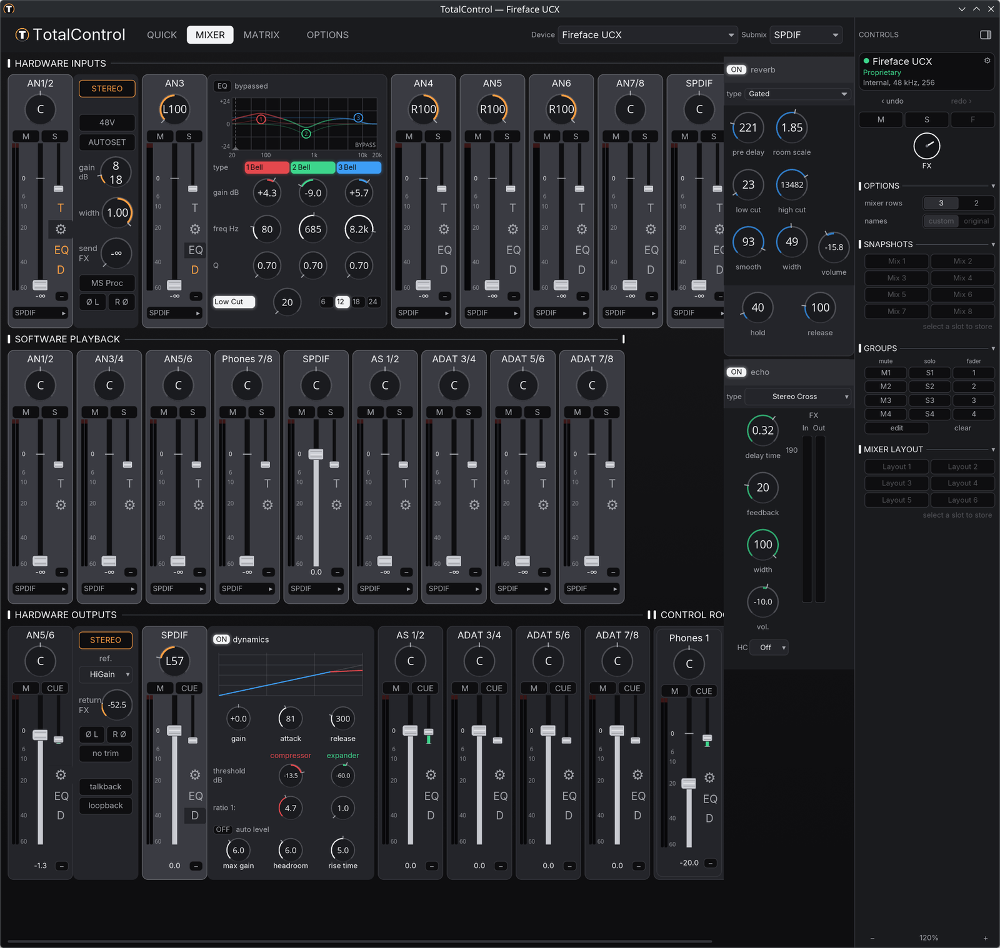

# TotalControl and the Fireface driver for Linux

Native Linux support for the RME Fireface UC and UCX, with experimental
Babyface-classic support, in normal RME vendor mode. TotalControl: give linux users total control over
their RME devices.



## Functionality

- **Fireface UC and Fireface UCX support, with experimental Babyface-classic support.**
- **Complete mixer with Control room** Mixer with channel strips that slide their panels in and out, EQ and dynamics (for the UCX).
- **MIDI in and out over USB.** 
- **Full OSC support.**  We support two RME OSC dialects: Classic and Global OSC, they can be used to control the complete mixer
- Unique feature: Automatic rate switching based on the media playser's requested bitrate. Allowing you to listen to high res audio at different bitrates without manual rate switching
- Unique feature: Easy configuration for surround audio - we create a virtual device that you select in your media player and TotalControl is configured automatically
- Completely documented: end user manual, installation and build, architecture, protocols

## Quick start

```sh
./scripts/build-kernel.sh
./scripts/reload-kernel.sh

cd ui/totalcontrol
cargo run -p totalcontrol-core --example fireface-scan --features alsa
cargo run -p totalcontrol-gui
```

`aplay -l` lists the cards and `ls -l /dev/snd/hwC*D*` lists the control nodes.
The kernel exposes no ALSA mixer controls; TotalControl uses the hwdep node.

The WirePlumber rule in `ui/totalcontrol/tools/alsa/wireplumber-uc.conf` selects the
18-channel Pro Audio profile and keeps ALSA scheduling polled.  Install it as
`~/.config/wireplumber/wireplumber.conf.d/60-fireface-uc.conf` and restart
WirePlumber.

## Documentation

- [Architecture](docs/TOTALCONTROL-ARCHITECTURE.md) — runtime layers, device
  service, control surfaces, driver and latency model.
- [GUI specification](docs/spec/TOTALCONTROL-GUI-SPEC.md) — layout, controls,
  panels, gestures and motion.
- [Channel template schema](docs/spec/TOTALCONTROL-CHANNEL-TEMPLATE-SPEC.md) —
  shared channel templates, layout configuration, invariants and preview.
- [Device profile specification](docs/spec/TOTALCONTROL-DEVICE-PROFILE-SPEC.md) —
  profile table, selection, host operations and scene compatibility.
- [UC protocol specification](docs/spec/FIREFFACE-UC-PROTOCOL-SPEC.md).
- [UCX protocol specification](docs/spec/FIREFFACE-UCX-PROTOCOL-SPEC.md).
- [Babyface-classic protocol specification](docs/spec/BABYFACE-CLASSIC-PROTOCOL-SPEC.md).
- [OSC 1.96 and Global OSC specification](docs/spec/TOTALCONTROL-OSC-SPEC.md).
- [User manual](docs/TOTALCONTROL-Manual.md).
- [Development tools](docs/DEVELOPMENT-TOOLS.md) — non-user-facing backends,
  capture and probe helpers.
- [Documentation index](docs/README.md).

## Architecture

The kernel module is a transport core:

- USB enumeration and per-device descriptors;
- alternate-setting and sample-rate selection;
- interrupt and isochronous URB engines;
- the ALSA PCM device;
- one `snd-hwdep` control node per card.

TotalControl owns the device model: matrix routing, faders, preamps, EQ/dynamics,
meters, clock/options and scenes. 

- `kernel/` — the kernel transport module.
- `ui/totalcontrol/` — TotalControl core, GUI and TUI.
- `docs/spec/` — authoritative specifications.

## Devices

| Device | USB ID | Audio transport |
|---|---|---|
| Fireface UC PC | `0424:3fc5`, `2a39:3fc5`, `2a39:3fce` | interrupt IF0 |
| Fireface UC AP | `0424:3fc6`, `2a39:3fc6` | isochronous IF0 |
| Fireface UCX | `0424:3fc9`, `2a39:3fc9` | isochronous IF0 (default) or interrupt IF5 |

The UCX uses the isochronous interface by default (`ucx_if5=0`); set
`ucx_if5=1` for the interrupt interface (this is experimental). We use
the better isochronous interface that is also used by the Apple RME driver.

One module instance handles several units.  TotalControl identifies each unit by
its serial number, remembers the selected unit across restarts, and opens that
exact unit again after a reconnect.  Scene files are kept per unit, including
two units of the same model.

## Kernel updates

Install the module through DKMS once:

```sh
./scripts/install-dkms.sh
```

The installer registers the source in `/usr/src/snd-fireface-uc-0.1`, builds
it for the running kernel, and installs and enables
`snd-fireface-uc-load.service`.  On Fedora, the kernel package's
`40-dkms.install` hook rebuilds the module for each new kernel.  No dnf plugin
or path watcher is needed.  Keep `kernel-devel` installed; the boot unit loads
the module after DKMS at the next boot.

Check the result with:

```sh
dkms status
modinfo -k "$(uname -r)" snd-fireface-uc
```

If a new kernel was installed without matching headers:

```sh
sudo dnf install kernel-devel-"$(uname -r)"
sudo dkms autoinstall -k "$(uname -r)"
sudo modprobe snd-fireface-uc
```

`scripts/install-kernel.sh` is a compatibility wrapper for the DKMS installer.

Before a sample-rate, channel-count or transport change, run the 48 kHz gate:

```sh
cd ui/totalcontrol
cargo build -p totalcontrol-core --example fireface-ctl --features alsa
cd ../..
scripts/ffuc-48k-gate.sh all
```

## License

The repository contains separate works under different licenses:

- `kernel/` — the Fireface UC/UCX kernel module, **GPL-2.0-only**, matching the
  kernel and the GPL-2.0 sources it builds on.
- Tools, scripts and documentation — **GPL-3.0-or-later**.  See
  [LICENSE](LICENSE).
- `ui/totalcontrol/totalcontrol-core` — **MIT**.
- `ui/totalcontrol/totalcontrol-gui` and `ui/totalcontrol/totalcontrol-tui` — **GPL-3.0-only**.

The UI notices are in [ui/totalcontrol/LICENSE](ui/totalcontrol/LICENSE) and
[ui/totalcontrol/COPYING](ui/totalcontrol/COPYING).

The module and the mixer meet at the kernel's hwdep ioctl interface; they are
not combined into a single work.

## Credits and attribution

This project is built on prior work, and we are grateful to its authors.

- [TuxMix](https://github.com/ismail-bahloul/TuxMix) by Ismaïl Bahloul
  (MIT core, GPL-3.0-only GUI/TUI) is the base of the mixer application: its
  device model, the TUI and the scene system. His
  commit history is archived on the `archive/tuxmix-upstream` branch, and the
  license and copyright notice stay in [`ui/totalcontrol/LICENSE`](ui/totalcontrol/LICENSE)
  and [`ui/totalcontrol/COPYING`](ui/totalcontrol/COPYING).
- [snd-fireface-uc](https://github.com/berndie/snd-fireface-uc) by Bernd Accou
  (MIT) is the earlier Fireface UC kernel driver; our UC transport follows its
  device modes, packet layout and status path.
- [rme-fireface-ucx-linux-driver](https://github.com/OroboroModular/rme-fireface-ucx-linux-driver)
  (GPL-2.0-or-later) is the Fireface UCX driver; our UCX transport, register
  model and meter decoding build on it.

The Fireface UC/UCX kernel module, the OSC layer and the GUI's mixer and
Control Room extensions were developed in this tree.  All Fireface protocol
knowledge comes from our own USB captures; no RME documentation or code is
included.  Full notices are in [`THIRD-PARTY.md`](THIRD-PARTY.md).

## How to contribute

Contributions are welcome through pull requests. Maintainers integrate accepted
work, keep `main` safe and own the project documentation. Device contributors
own the hardware evidence and testing: the model, firmware, transport, sample
rate and quantum, and confirmation that the user scene and
`~/.config/totalcontrol/gui.json` are preserved.

We may merge a minimal, device-specific implementation without waiting for full
support. Full support requires the contributor to test the integrated tree and
resolve or report the follow-up issue. After integration, sync `main`, build
against your kernel, test, and close your original pull requests yourself once
verified.

Missing protocol details and hardware follow-ups belong in a tracking issue.
They do not block maintainer progress on other devices. Do not include personal
data or captured device state in a pull request or issue.

See [`AGENTS.md`](AGENTS.md) and the
[pull request template](.github/pull_request_template.md) for the repository
rules.

