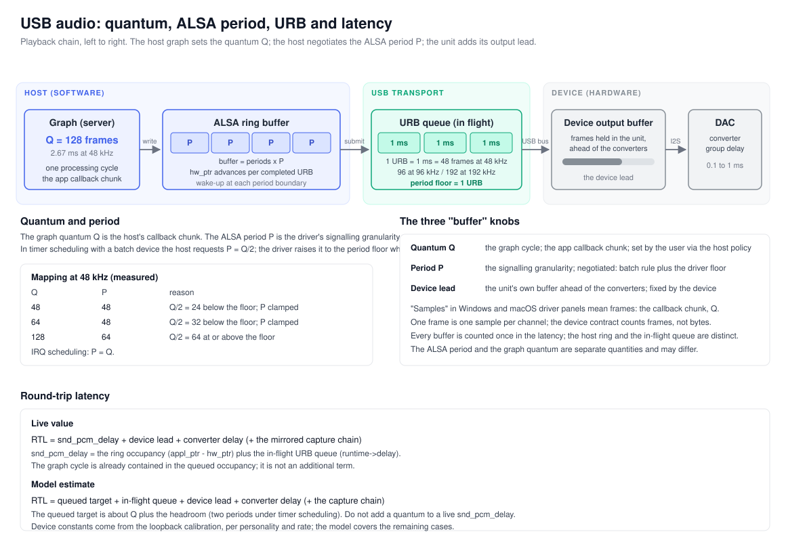
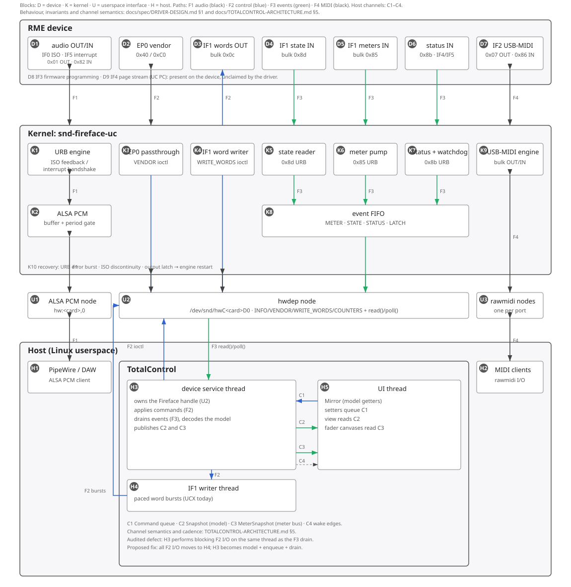

# Fireface USB driver design

This document describes the `snd-fireface-uc` kernel module: what it owns,
how it streams audio, how it talks to the host, and how to extend it to
another RME device. It is the low-level driver reference. Device protocol
encodings live in the protocol specifications. Mixer panels, scenes and GUI
behaviour belong to the host specifications.

Terminology:

| Term | Meaning |
|---|---|
| host | Any userspace client of the driver's PCM/hwdep interface: TotalControl, a command-line tool, or the vendor reference host on Windows or macOS. |
| reference host | The vendor's host driver, used as protocol evidence. |
| transport | The USB streaming path: interrupt or isochronous. |
| USB interface | A numbered `bInterfaceNumber` in the active configuration (IF0 audio, IF1 state/meter, IF2 MIDI, IF3 firmware programming, IF4 page stream, IF5 status). The protocol specifications own the numbering. |
| userspace interface | An ALSA node the host opens: PCM, hwdep or rawmidi. |
| personality | A device firmware/USB variant: UC PC, UC AP, UCX IF0, UCX IF5, Babyface-classic. |
| engine | The running URB set for one card. |
| quirk | A descriptor flag that selects a device-specific transport behaviour. |
| device clock | The device's master sample clock (its crystal). The host follows it; capture and playback both run on it. |
| capture stream | The device→host audio stream (IN). Runs whenever the engine runs; its timing reveals the device clock. |
| playback stream | The host→device audio stream (OUT). |
| implicit feedback | Recovering the device clock from the capture stream's timing and locking playback to it; no separate sync endpoint. |
| position counter | The device's free-running sample counter, reported in each capture header; wraps at the rate-band modulus (§4.3). |
| frame count | The number of samples in a capture packet; varies by ±1 with clock drift (the add/drop). |
| phase | The fractional clock accumulator in the capture header (sub-sample timing). |
| lead word | The position label on a playback frame: the stream position the frame plays at. |
| output buffer | The device buffer the DACs read from; playback frames are placed into it at their lead-word positions. |
| lead margin | `out_lead`; frames the host labels ahead of the capture position to keep the output buffer fed across jitter. |

Terms follow the USB core and ALSA conventions. Driver-specific terms are
defined above.

## Overview

### The device clock and implicit feedback

The Fireface is the clock master. Its converters run on the device clock and
the host follows it. Both audio directions share that one clock: the capture
stream (device→host) and the playback stream (host→device).

The capture stream runs whenever the engine runs, even when nothing is being
played back. The reason is clock recovery: the device captures at its own
rate, so the frame count and the position counter in each capture packet
reveal the true device clock to the host. This is implicit feedback — the
capture stream itself carries the clock information, so no separate sync
endpoint is needed. The host measures the device rate from the capture timing
and locks playback to it.

Each capture packet begins with a 4-byte header: the frame count (bits 0–4),
the position counter (bits 5–17 at 1x, widening at 2x/4x), and the phase
(bits 21–31). The audio samples follow the header.

A playback frame carries a lead word naming the stream position the frame
plays at. On the UCX each frame is one lead word plus the channel samples; the
lead word is the only extra word — the frame size is implicit from the
transfer length and the format. The device places each playback frame into its
output buffer at the position named by the lead word; the DACs read that buffer
at the device clock.

The host derives the lead word from the capture position it just learned, plus
the lead margin that keeps the output buffer stocked ahead of the DAC read
position and absorbs USB and scheduling jitter. The loop is:

1. The device captures; the capture header reports position + frame count (the
   device clock).
2. The host reads it and learns the device position and rate.
3. The host labels playback frames with lead words = device position + lead
   margin.
4. The device places them in the output buffer; the DACs play them at the
   device clock.

If the lead words run ahead of the real device position, the device is asked to
play frames it has not reached: the output buffer starves and a gap or
distortion is heard. The lead must stay locked to the capture position (§4.3).

### From the device clock to Linux: quantum, period, URB, latency

The host delivers playback through the ALSA PCM buffer. The playback chain is:
application → ALSA ring → in-flight URBs → device output buffer → converters.
Each stage holds frames; the round-trip latency is the sum of what each stage
holds at the moment of measurement. Three quantities belong to three layers:

| Quantity | Layer | Meaning |
|---|---|---|
| quantum `Q` | host (PipeWire) | the graph cycle in frames; the application callback chunk ("samples" in a driver panel) |
| period `P` | ALSA / driver | the buffer chunk whose completion raises a period signal; the driver minimum is one URB (the period floor) |
| URB | USB | one transfer; ISO bundles `iso_packets` microframes (1 ms at the shipped geometry) |

The device output buffer and the converter delay are fixed device terms. The
quantum and the period are host/driver choices that set the scheduling margin
and the latency. The ring fill is the queued reserve and equals the steady
ring latency; `out_lead` is the driver's scheduling horizon (§4.1.2), a
margin that keeps the device output buffer fed — not held audio, since the
device plays largely on arrival. The diagram below shows the chain; the full
geometry, the achievable envelope and the scheduling policy are in
§4.1.1 and §4.1.2.



The sections that follow dive into the technical detail: the driver/host
boundary (§1), descriptors (§2), the control transports (§3) and the streaming
engine (§4).

## 1. Boundary

The kernel module is a transport driver. The host owns the device model and
policy.

| Layer | Owns |
|---|---|
| `kernel/ffuc.c` | USB probe, descriptor table, alt/rate selection, URB engines, ALSA PCM, status/latch watchdog, recovery, suspend/resume |
| `kernel/ffuc-hwdep.c` | raw EP0 vendor requests, IF1 word bursts, meter/state readers, event queue, backpressure |
| `kernel/ffuc-midi.c` | USB-MIDI rawmidi ports |
| host | device model, protocol semantics, routing, scenes, meter decoding |

The kernel exposes these userspace interfaces:

- the ALSA PCM device (`hw:<card>,0`);
- one `snd-hwdep` control node per card (`/dev/snd/hwC<card>D0`);
- rawmidi ports where the device has USB-MIDI.

The host opens the hwdep node and implements the device model. The hwdep
node is the single control owner while the module is bound.

The driver claims the audio, state/meter, MIDI and status USB interfaces.
The firmware programming USB interface (IF3) and the page stream USB
interface (IF4) remain unclaimed; the firmware update tool uses IF3
directly.



The diagram's blocks carry stable IDs. The tables below define each
block and each path; the normative text references the IDs.

### 1.1 Blocks

| ID | Block | Responsibility | Source |
|---|---|---|---|
| D1 | audio OUT/IN | the device's streaming endpoints (IF0 ISO or IF5 interrupt) | device |
| D2 | EP0 vendor | the device's control request endpoint | device |
| D3 | IF1 words OUT | register-word sink, bulk `0x0c` | device |
| D4 | IF1 state IN | state-echo source, bulk `0x8d` | device |
| D5 | IF1 meters IN | meter-heartbeat source, bulk `0x85` | device |
| D6 | status IN | status ticker and output-latch bit, `0x8b` | device |
| D7 | IF2 USB-MIDI | MIDI packet endpoints | device |
| D8/D9 | IF3 / IF4 page stream | firmware programming and page stream; unclaimed | device |
| K1 | URB engine | submits and completes audio URBs; ISO implicit feedback (§4.3) or interrupt handshake (§4.4); cadence and continuity guards | `ffuc.c` |
| K2 | ALSA PCM | the coherent PCM buffer and the duplex period gate (§4.2); fed exclusively by K1 | `ffuc.c` |
| K3 | EP0 passthrough | one synchronous vendor request per `VENDOR` ioctl, bounded by the USB timeout | `ffuc-hwdep.c` |
| K4 | IF1 word writer | one `WRITE_WORDS` burst per ioctl, ≤63 words, odd parity added | `ffuc-hwdep.c` |
| K5 | state reader | resubmits the `0x8d` URB; emits STATE events | `ffuc-hwdep.c` |
| K6 | meter pump | reader-triggered `0x85` submission with backpressure (§5.1); UC pair model | `ffuc-hwdep.c` |
| K7 | status + watchdog | the `0x8b` URB; STATUS and LATCH events; the output-latch watchdog (§4.6) | `ffuc.c` |
| K8 | event FIFO | the 64 KiB event queue; `read()`/`poll()` drain it; a full FIFO drops events | `ffuc-hwdep.c` |
| K9 | USB-MIDI engine | bulk MIDI transfers, one stream per transfer | `ffuc-midi.c` |
| K10 | recovery | marks the engine broken and restarts it (§4.6) | `ffuc.c` |
| U1 | ALSA PCM node | `hw:<card>,0` | ALSA |
| U2 | hwdep node | `/dev/snd/hwC<card>D0`; INFO/VENDOR/WRITE_WORDS/COUNTERS ioctls and the event stream | `ffuc-hwdep.c` |
| U3 | rawmidi nodes | one per logical MIDI port | ALSA |
| H1 | PipeWire / DAW | the ALSA PCM client | host |
| H2 | MIDI clients | rawmidi clients | host |
| H3 | device service thread | owns the device handle; applies commands as model updates plus queued I/O; drains events; publishes snapshots | host |
| H4 | control-I/O worker | executes all control I/O (word bursts, vendor requests, ordered scene batches) in submission order; owns the pacing | host |
| H5 | UI thread | the mirror and the canvases | host |

H3–H5 and the host channels C1–C4 are defined in
[`../TOTALCONTROL-ARCHITECTURE.md`](../TOTALCONTROL-ARCHITECTURE.md) §5.

### 1.2 Paths

| Path | Route | Payload | Direction |
|---|---|---|---|
| F1 audio | D1 ↔ K1 ↔ K2 ↔ U1 ↔ H1 | sample frames; period signals pace H1 | bidirectional |
| F2 control | H3/H4 → U2 → K3/K4 → D2/D3 | vendor requests and register words | host to device |
| F3 events | D4/D5/D6 → K5/K6/K7 → K8 → U2 → H3 | STATE, METER, STATUS, LATCH events | device to host |
| F4 MIDI | D7 ↔ K9 ↔ U3 ↔ H2 | USB-MIDI packets | bidirectional |

F1 carries audio only; F2 and F3 share U2 but are independent: ioctls
never wait on the event drain, and the drain never waits on an ioctl
held by another reader.

### 1.3 Invariants

1. **Single control owner.** U2 is the control owner while the module is
   bound; the host opens it exclusively for control (H3).
2. **Prompt drain.** K6 submits the next meter page only while K8 is
   below its high-water mark (backpressure). H3 drains K8 promptly; a
   stalled H3 pauses K6 and, beyond the FIFO capacity, drops events
   (`events_dropped`).
3. **Single meter reader.** One reader drains F3; concurrent readers
   break the UC pair phase (§5.1).
4. **Control ordering.** F2 operations reach the device in submission
   order; a vendor request never overtakes queued words.
5. **Bounded control.** K3 and K4 ioctls are synchronous and bounded;
   F3 reads wait interruptibly.
6. **Recovery is an xrun.** K10 restarts the engine; H1 re-prepares
   (§4.6).

## 2. Device descriptors and quirks

`struct ffuc_device_desc` is the per-device table. USB IDs point at
descriptors through `.driver_info`. Each probe allocates its own
`struct ffuc`; model state is per-card.

A descriptor carries:

- identity: name, card id, vendor/product;
- transport: interface number, interrupt or ISO, audio/status/state/meter/MIDI
  endpoint numbers;
- modes: one `ffuc_mode` per alternate setting (words, packet sizes, max
  frames);
- channel counts, max rate, meter length;
- channel-init ranges (`0x16` slot ranges);
- quirks;
- `ffuc_ops` callbacks: `init`, `set_rate`, `stream_start`, `stream_stop`,
  `hw_mute`.

Quirks:

| Quirk | Meaning |
|---|---|
| `ALT_RESELECT` | select alt 0 then alt N at engine start (clears the UCX IF5 output latch) |
| `STATUS_LATCH` | status byte 3 bit 7 is the output-latch watchdog |
| `IF5_PRE_START` | send `0x10 0x8000` + `0x1d` before audio |
| `IF5_PLAYBACK_MASK` | request 19/20 channel mask; IN URBs are 73728 bytes |
| `WIN_SESSION` | Windows-personality session timing: stop->start settle and close->rate / close->trio gaps |

Model-specific behaviour belongs in a descriptor quirk or an `ffuc_ops`
callback; the shared PCM/URB path stays model-independent.

## 3. Personalities and wire formats

| Personality | Transport | Wire | Notes |
|---|---|---|---|
| UC PC | interrupt IF0 | S32 | status ticker IF5; session words after a live rate change |
| UC AP | ISO IF0 | float32 | IN header + planar frames; OUT per-frame lead word |
| UCX IF0 | ISO IF0 | float32 | default UCX path |
| UCX IF5 | interrupt IF5 | S32 | opt-in `ucx_if5=1`; Windows mode-setup block, alt 1 at 1x |
| Babyface-classic | ISO IF0 | float32 | UCX-family packet format; 12 capture / 14 playback words at 1x |

The wire format is keyed to the transport: interrupt personalities carry
S32 (the Windows reference pairing), ISO personalities carry float32
(the macOS reference pairing). The device accepts either format when the
channel-init value matches. The driver resolves the format at probe
(`ffuc_wire_s32`) and writes the matching `0x16` value, so wire and init
always agree. The kernel converts between the wire format and the ALSA
format.

The transport operation of each personality is defined in §4.3 (AP mode),
§4.4 (PC mode) and the comparison in §4.5.

The UC keeps its rate family across personality switches; a USB reset
restores the 1x multiplier and forces a session replay on PC.

## 4. Streaming engine

### 4.1 URB and buffer geometry

Module parameters: `urb_frames` (default 48), `nurbs` (default 2),
`ucx_if5_frames` (default 1024), `fixed_rate`.

- Interrupt: one URB carries `urb_frames` scaled by the rate band
  (1x/2x/4x). The PCM buffer covers `(nurbs + 2) * urb_frames`, rounded up
  to whole periods.
- ISO: one URB carries up to 8 packets, one per 125 us microframe. The
  feedback delay is `(nurbs + 1) * iso_packets`. The UCX PCM buffer also
  covers the output lead plus two URBs of margin.
- The period floor is one URB. The graph quantum follows at 48 frames and
  above.

#### 4.1.1 The achievable envelope

The driver is the single owner of the supported rates and the per-rate
quantum envelope. It computes them with the same functions that refine
`hw_params` (`ffuc_urb_frames`, `ffuc_buffer_min`) and reports them through
`FFUC_HWDEP_IOCTL_ENVELOPE` (ABI 5). Userspace queries the envelope once per
attach and presents exactly what the driver reports. It does not recompute
the geometry.

| Term | Layer | Definition |
|---|---|---|
| URB | USB | one USB transfer; carries `urb_frames` frames at 1x, scaled by rate |
| period | ALSA | `period_size`; the buffer chunk the driver signals on completion |
| period floor | driver | the minimum period the driver accepts at a rate; one URB |
| buffer | ALSA | `buffer_size`; the circular buffer, an integer number of periods |
| buffer min | driver | the minimum buffer the driver accepts at a rate; URB-aligned |
| quantum | PipeWire | the graph cycle in frames (`clock.quantum`) |
| pitch envelope | driver | the varispeed range the transport carries at a rate; the programmed clock stays at or below the band's packet capacity |

With `api.alsa.disable-tsched` the quantum equals the period; the period floor
is therefore the minimum quantum. `urb_frames` sets the period floor; `nurbs`
sets the buffer.

USB high-speed carries 8000 microframes per second (125 µs each). At rate R a
microframe carries R/8000 frames. The ISO engine bundles `iso_packets`
microframes into one URB; at `urb_frames=48`, `iso_packets=8`, so one URB spans
1 ms and carries `8 × ceil(R/8000)` frames. The driver signals completion one
URB at a time, so the period floor is one URB. The ceiling packs whole frames
per microframe; the fractional remainder is the feedback add/drop (§4.3).

The ISO endpoint's high-bandwidth capacity bounds the programmed clock. The
4x endpoint carries 2 × 652 bytes OUT and 2 × 604 bytes IN per microframe
(25 frames at the 4x word width); `max_frames` is 7 / 13 / 25 at 1x / 2x / 4x.
The band capacity is `8000 × max_frames` frames/s: 56000 / 104000 / 200000.
The pitch envelope keeps the programmed clock `R × (1 + pitch/100)` at or
below the band capacity:

```text
capacity(band) = 8000 * max_frames(band)
pitch_max(R)   = min(5 %, (capacity(band(R)) / R - 1) * 100)
```

Every rate carries the full ±5 % except 192 kHz positive pitch, which ends at
+4.1667 % (200000 / 192000). The driver clamps the active family's DDS divisor
word to the ceiling on every vendor DDS write (`ffuc_dds_clamp`, counted by
`pitch_clamps`); the clamped divisor rounds up on the word's 256-unit grid so
the decoded clock stays at or below the capacity. The other families' words
pass untouched. The rate sequence writes nominal words, which are always in
envelope. Above the ceiling the device's capture cadence folds back and the
transport errors, so the clamp is a correctness boundary, not a preference.
The GUI offers the same envelope on the pitch slider (0.1 % grid).

```text
ISO:           urb = iso_packets * ceil(rate / 8000)
               iso_packets = clamp(ceil(urb_frames / 6), 1, 8)
interrupt UC:  urb = urb_frames << band(rate)
               band = 0 (<=48k), 1 (<=96k), 2 (>96k)
interrupt UCX: urb = ucx_if5_frames
period_floor   = urb
buffer_min     = roundup(max((nurbs + 2) * urb, lead + 2 * urb), urb)
               UCX only: lead = round((nurbs + 1) * iso_packets * rate / 8000) + 60
```

`roundup()` rounds to any multiple. `round_up()` is a power-of-two bitmask and
mis-aligns a non-power-of-two URB; the buffer rule uses `roundup()`.

ISO envelope at the defaults (`urb_frames = 48`, `nurbs = 2`), as reported by
the envelope ioctl:

| Rate | period floor | buffer min |
|---|---|---|
| 32000 | 32 | 224 |
| 44100 | 48 | 288 |
| 48000 | 48 | 336 |
| 64000 | 64 | 384 |
| 88200 | 96 | 576 |
| 96000 | 96 | 576 |
| 128000 | 128 | 768 |
| 176400 | 184 | 1104 |
| 192000 | 192 | 1152 |

The envelope ioctl reply (`struct ffuc_hwdep_envelope`):

| Field | Type | Meaning |
|---|---|---|
| count | u32 | valid rate entries |
| urb_frames | u32 | base URB frames (loaded parameter) |
| nurbs | u32 | URBs in flight per endpoint |
| iso | u32 | 1 ISO, 0 interrupt |
| rates[16] | u32×3 each | `{rate, period_floor, buffer_min}` per supported rate |

The supported rates are `ffuc_rates` filtered by the model's `max_rate`. The
envelope is static for a module load. It changes only on reload (new
parameters) or a different model. PipeWire's `min-quantum`, `max-quantum` and
`allowed-rates` are host policy and must permit the envelope; the installer
owns that policy.

The host scheduling policy is one: interrupt scheduling with the period-aligned
cushion. The startup prefill gate (§4.1.3) mutes the outputs from trigger until
delivery is stable on every path.

**Interrupt scheduling (the policy).** IRQ scheduling
(`api.alsa.disable-tsched = true`); the graph wakes on the device's period
interrupts. TotalControl holds a period-aligned scheduling cushion, the
playback headroom `H = 2·P`, on both Pro Audio nodes. The IRQ wake threshold
`P + H` is a whole multiple of the period. At fractional rates the URB cadence
does not divide the period; a non-aligned threshold lands mid-period, doubles
the write-skip rate and collapses the ring fill. The aligned cushion holds the
fill clean at every supported rate under load. TotalControl sets the cushion
before it writes the rate or quantum, so the value is in place when the
re-prepare reads it — the reference pattern (the host sets rate and margin
together, then restarts). The cushion is the host half of the reference margin
pair; the device lead bias (§4.1.2) is the device half. The packaged fallback
uses interrupt scheduling with no extra headroom; TotalControl sets `2·P` at
runtime.

**JACK.** Opens the PCM directly and fills the ring just-in-time; the PipeWire
policy does not apply. It is the lowest-latency path.

**Varispeed (pitch) tracking.** The Pro Audio playback node follows the device
clock through the graph wake cadence, not a resampler. Under interrupt
scheduling the wake cadence is the device's period interrupts at the pitched
rate, so the playback follows a pitched clock directly. A pitched clock
belongs only to an interrupt-scheduled graph and is applied after the IRQ
policy is established. The programmed clock stays within the pitch envelope
(§4.1.1): the driver clamps every DDS write to the band's packet capacity, so
the device never runs a clock the transport cannot carry.

**Start preconditions.** A start is correct only when it reaches the
fresh-start state before real audio flows:

| Precondition | Ground truth |
|---|---|
| PCM and graph at the target rate | `hw_params`, graph clock |
| device clock stable at that rate (no rate-change transient) | `rate_meas` |
| ring primed to `start-delay + period + headroom` | prepare prime |
| client audio delivered without dropped buffers | playback buffers |

The prepare path returns the queued playback buffers to the client, and a rate
change makes the device clock transient. A correct re-prepare of a running
stream re-establishes these preconditions before audio resumes; the fresh
start (the ring primed during the silent window, before client audio) is the
reference. The graph rate is conducted by the playing stream; a re-prepare
preserves that conducted rate rather than re-imposing the default.

The steady ring fill carries the margin and is the host's queued latency.

The ring capacity (`period-num × period`) is the stall headroom. It absorbs
late host writes. It is mostly empty in steady state, so a large capacity
adds no steady latency; the steady latency is the ring fill, not the
capacity.

The IRQ-mode wake thresholds are
`avail_min = buffer − (period + headroom)` (playback) and
`avail_min = min(period + headroom, buffer)` (capture); both degenerate
when `headroom ≥ buffer − period`, so the shipped period count keeps
`buffer > period + headroom` down to the 32-frame period floor. The larger
buffer is latency-neutral: the delay target is `period + headroom` and the
start prefill is `start-delay + period + headroom`; neither depends on the
buffer size.

Lower `urb_frames` shortens the URB and lowers the period floor (lower
latency). Raising `nurbs` enlarges the buffer (more margin); the period floor
is unchanged.

The period floor bounds the quantum from below: the driver accepts any period
≥ the period floor. The GUI offers the standard quantum steps filtered to ≥ the
period floor, plus the exact floor, so the lowest achievable latency is
selectable. A larger quantum is a larger period: more latency, more scheduling
margin.

The PCM buffer covers the URBs already in flight plus margin. Ring pressure
is measured against the driver's own ring position — the position the
completion reads (playback) or writes (capture) — not the published status
pointer, which refreshes only on a period signal and lags the driver position.

A playback completion that cannot supply its frames from written ring data
sends silence for that URB. It never sends unwritten ring content. The lead
counter anchors at the first feedback position even when that URB is starved,
and the lead words advance by the mirrored frame count, so the silence URBs
carry the device timeline. The first starved completion of an episode is
counted once as `out_underruns`. A single starved completion is a grace: the
next completion resumes normally when the ring has caught up, and the episode
is heard as a one-URB gap. The first four completions after trigger start are
a start grace: starved URBs send silence without stopping, because the
stream-start prefill can be smaller than the first URB's demand after a rate
change or renegotiation and the host catches up within a few URBs. After the
start grace, two consecutive starved completions stop the stream as an XRUN.
The engine keeps running and feeds the device silence while the application
recovers through prepare/start. A capture completion that overwrites unread
frames is counted as `in_overruns`; the device keeps streaming, so the capture
stream is not stopped. The host prevents both through its buffer/quantum
choice.

#### 4.1.2 Host timing terms


The playback chain is: application → ALSA ring → in-flight URBs → device
output buffer → converters. The latency is the sum of the frames held ahead
of consumption at the moment of measurement.

Three quantities are distinct and must not be conflated:

- **Ring fill** (`appl_ptr − hw_ptr`): the data queued in the ALSA ring. It
  is both the stall reserve and the steady ring latency — the host
  write-ahead. This is the quantity the host scheduling policy holds.
- **In-flight queue**: frames handed to USB and not yet completed.
- **`out_lead`** (lead margin): the scheduling horizon — how far ahead of the
  mirrored device position the OUT lead word is placed. It is a scheduling
  safety margin that keeps the device output buffer fed across jitter, not
  the ring fill and not held audio. The lead word is a horizon: the device
  plays largely on arrival, so the measured playback path (bus delivery +
  converter) is smaller than `out_lead`.

| Term | Layer | Definition |
|---|---|---|
| graph quantum `Q` | host | the frames one graph cycle processes; the application callback chunk |
| ALSA period `P` | driver/host | the frames per period: the chunk whose completion raises a period signal and advances the pointer |
| ALSA ring | driver | `P × periods` frames between the application and the driver |
| ring fill | driver/host | `appl_ptr − hw_ptr`; the queued reserve, equal to the steady ring latency |
| URB | USB | one transfer of `iso_packets` microframes; 1 ms at the shipped geometry |
| period floor | driver | the smallest accepted period: one URB |
| in-flight queue | driver | frames handed to USB and not yet completed (`nurbs` URBs) |
| `out_lead` | driver | the scheduling horizon added to the mirrored position; a scheduling margin, not held audio |
| device output buffer | device | the frames the unit holds between arrival and conversion; small, since the device plays on arrival |
| converter delay | device | the AD/DA group delay |

`out_lead` = `fb_delay·rate/8000 + lead bias`. The first term compensates
the feedback read offset: the OUT mirrors an IN position `fb_delay` packets
old, so the term brings it back onto the current device timeline. The lead
bias is `2·max_frames−2` (12/24/48 at 1x/2x/4x), the same on the UC, UCX and
Babyface-classic. The bias is added to every lead word and is set at engine
start, not adjusted while streaming. A bias below it underruns. The
`lead_margin` module parameter overrides the bias for measurement.

The lead bias is the device half of the reference margin pair; the host
half is the scheduling cushion the host policy holds (§4.1). The device
lead is a scheduling horizon, not held audio: the device plays largely on
arrival, so the measured playback path is smaller than `out_lead`.

The graph quantum and the ALSA period are separate quantities. Under
interrupt scheduling the host uses `P = Q`. In the timer fallback (not a user
policy) with a BATCH device the host requests `P = Q/2`; the driver raises the
period to the floor when the request falls below it, and the graph keeps
running at `Q`. The period therefore does not identify the quantum. Measured
at 48 kHz: `Q` 48 → `P` 48; `Q` 64 → `P` 48; `Q` 128 → `P` 64.

Three "buffer" knobs belong to three layers:

| Knob | Meaning | Set by |
|---|---|---|
| quantum `Q` ("samples" in an application's buffer setting) | the graph cycle, the application callback chunk | the user, through the host policy |
| period `P` | the signalling granularity | the host, negotiated with the driver floor |
| ring fill | the queued reserve = steady ring latency | the host scheduling policy (`start-delay`/`headroom`) |
| `out_lead` | the device scheduling margin (horizon, not held audio) | the driver (`lead_margin` parameter) |

"Samples" in a Windows or macOS driver panel mean frames: the callback chunk,
which is the quantum here.

#### 4.1.3 Startup prefill gate

The playback outputs stay muted from the playback trigger until the ring
delivery is stable. The gate covers the startup transient, when the host
graph ramps and the ring fill dips below the per-URB demand. It is a
startup mechanism: steady-state delivery and latency are unchanged.

| Term | Shape | Definition |
|---|---|---|
| prefill gate | per playback stream | the mute-until-stable state armed at trigger START/RESUME |
| minimum window | `FFUC_PREFILL_MIN_MS` = 64 ms | the shortest muted hold, sized at 2× the worst measured startup dip (30 ms) |
| stability run | `FFUC_PREFILL_STABLE_MS` = 4 ms | consecutive non-starved, anchored completions required to clear |
| hard bound | `FFUC_PREFILL_MAX_MS` = 256 ms | the longest muted hold; clears even if the host never delivers |
| `prefill` | module param, bool, default on | enables the gate; off clears an armed gate at the next fill |

The constants are milliseconds. At arm time they scale to completion
counts by the URB duration (`urb_frames * 1000 / rate`, minimum 1 ms): an
ISO URB is 1 ms at every rate, an interrupt URB is rate-dependent. The
minimum window is at least one completion; the bound exceeds the minimum.

The gate arms in the common playback trigger and is evaluated at each
playback fill in both transports (ISO and interrupt). A completion that is
non-starved and anchored advances the stability run; a starved or
unanchored completion resets it. The gate clears when the age reaches the
minimum window and the stability run reaches its target, or when the bound
expires. Clearing queues the unmute on a workqueue: the mute op is a
sleeping USB transfer, while the trigger and fill run in atomic context.
The device writes stay the per-model `hw_mute` op (UCX/Babyface playback
mask, UC mute word).

Engine start holds the playback outputs muted while the gate is active, so
the output stays muted from engine start through the trigger until the gate
unmutes. The gate is the sole owner of the startup unmute; engine start
does not unmute ahead of it (the stream-start DAC-open sequence unmutes,
and engine start re-mutes after it).

While the gate is armed, a starved completion sends silence without
counting `out_underruns` and without arming the XRUN stop: the muted
transient is intended startup. The existing priming keeps feeding the
device timeline while muted; ring data flow and `hw_ptr` accounting are
unchanged. After the gate clears, normal underrun accounting resumes.

A fill-level threshold cannot gate real audio: the host startup prefill is
silence written into the ring, so `appl_ptr − hw_ptr` reaches any fill
threshold before real audio exists. Delivery stability is the gate
condition.

Counters: `out_prefills` (gated startups that unmuted stable),
`out_prefill_timeouts` (gated startups that hit the bound), in debugfs
stats.

The measured startup dip spans 0–30 ms after trigger (IRQ mode, sd0); the
64 ms minimum window covers it with margin and the stability run confirms
recovery. The audible result is one clean muted window of ≈50–100 ms per
start or rate switch, then continuous audio. See §7 for the device start
margin that precedes the first URB at an engine restart.

### 4.2 Period signalling gate

A period signal announces one completed period. A direction is signalled
only when its period index advanced (`delta_zero` counts violations).

In duplex with equal ALSA periods, the wake is withheld until both running
directions have completed a period, so the follower's pointer is current when
the reader wakes. A direction whose wake has been withheld twice signals
alone, releasing the other direction. Single-direction operation signals at
its own boundary.

The gate applies only when both directions have the same ALSA period. Unequal
periods have no common boundary, so cross-gating would withhold one direction
on every cycle and turn the gate into a source of late writes. Each direction
is then signalled at its own boundary, like single-direction operation.

The two directions' completions can run concurrently on different CPUs.
`gate_lock` serializes the gate decision and its deferral counters; the
stream lock inside the signal nests under it.

Counters: `signal_deferred`, `signal_overdue`, `max_pending`, `delta_zero`,
`hw_ptr_mismatch`.

The gate adds at most about one URB of latency at equal periods. It is a
correctness mechanism.

### 4.3 ISO implicit feedback (AP mode)


The diagram details K1 on path F1; block IDs continue §1.1. The device
captures and plays from one clock, so the captured stream is the
playback clock reference. The loop:

1. **A1.** D1 delivers IN packets; the header carries position, phase
   and frame count.
2. **A2.** K1.1 records every IN packet's position, frame count and
   phase in K1.2 (`fb[]`), indexed by packet number.
3. **A3.** K1.3 reads the entry `fb_delay` packets behind the current
   OUT packet.
4. **A4.** K1.3 places the lead word at the recorded position plus
   `out_lead`, mirrors the frame count, and sends the packet to D1.

This is implicit feedback: the device's captured clock schedules
playback, keeping the two directions aligned.

**Priming.** The OUT stream starts before the feedback ring holds
entries for it. The first `fb_delay` OUT packets of a run are the
priming window. A priming packet carries the programmed frame count
(the programmed clock / 8000, fractional part carried), so the device
output buffer stays fed before feedback exists at the rate the device
actually consumes. The lead words advance at the programmed cadence
through the window. A re-prepare under pitch therefore primes at the
pitched clock; priming at nominal under pitch leaves a supply deficit
that starves the ring and churns XRUN recovery, because every recovery
primes again. The data is silence while the stream is not running or
the host ring is dry; an anchored, filled stream sends ring data in the
priming window like in any other packet.

**The lead anchor seed.** The lead counter starts from the device
timestamp: the unwrapped position rewound by the packets between the
feedback slot and the fill moment, plus `out_lead`. The seed requires a
valid device timestamp (at least one real capture header). The rewind
can reach before the first header of the run; the position counter
free-runs at the committed rate, so the extrapolated position stays on
the device timeline. Until the seed anchors the counter, playback
packets carry silence; ring data waits for the anchor. From the seed,
the counter advances by the frames sent: nominal frames in the priming
window, mirrored frames once feedback exists. The nominal cadence is
the committed rate; the mirrored cadence is the device's captured
rate. The two agree to within the clock drift over the priming window,
so the handover carries no cadence step. The lag watermarks record the
anchored counter only.

**What drives the loop.** Two device fields schedule the OUT stream:
the position anchors the lead word (K1.3 initializes its lead counter
from the recorded position plus `out_lead`, then advances it by the
frames sent), and the frame count is mirrored per packet. The mirroring
is the rate lock: a device clock running slightly fast occasionally
captures one extra frame in a microframe, the count carries that
add/drop, and OUT reproduces it. The long-term OUT rate therefore
equals the device's capture rate, fractional part included.

**Run-scoped delivery accounting.** The OUT fill checks each packet's
delivery against the URB's previous submission in the same engine run.
A non-zero completion status counts as `out_pkt_status`; a short delivery
with status zero counts as `out_pkt_len_err`. Engine setup clears the OUT
packet descriptors of the reused URBs before the first fill. A delivery
cancelled at the previous run's stop is a cancellation, not a transport
error, and never counts against the new run.

The phase is recorded in `fb[]` and exposed for diagnostics.
The scheduler mirrors the frame count, which already carries the add/drop.
The driver also consumes the phase for the device timestamp: each IN
packet pairs the unwrapped device position with the host time of the next
packet boundary (the start-frame anchor), and the one-second window over
those pairs is `rate_meas`, the add/drop-inclusive device rate.  The seed
of the OUT lead anchor is computed from the same timeline (rewinding the
unwrapped position by the packets between the feedback slot and the fill
moment), value-equivalent to reading the feedback ring.  The phase's
fractional term is capture-pinned (Stage 1 gate 3): the exact position is
`pos + phase/tps` (the device is ahead of its delivered count by the owed
fraction; the add pays it at the wrap), and the phase advances one
microframe per packet mod tps regardless of the frame count.  The
timestamp position follows the device's own field. The device resets
its capture stream counter when the host restarts polling after a stop.
The ISO start margin (§7) lets the reset complete before the first URB,
so the run starts on a clean zero-based timeline. A reset caught
mid-flight emits the start ramp: position-0 placeholder packets and a
position jump into the reset timeline. The first position discontinuity
of a run is that ramp resync. It re-seeds the continuity expectation and
is not counted. Later discontinuities count as `in_pos_gap`. The
unwrapped field model carries the resync; rate_meas uses the continuous
count model.
Whether the macOS reference host additionally consumes phase for
fractional prediction is an open item (§12).

The field names below are the protocol-spec terms; the bit layouts and
the phase law live in
[`FIREFFACE-UC-PROTOCOL-SPEC.md`](FIREFFACE-UC-PROTOCOL-SPEC.md) §11.6
and [`FIREFFACE-UCX-PROTOCOL-SPEC.md`](FIREFFACE-UCX-PROTOCOL-SPEC.md)
§12.1.

| Term | Definition | Used by |
|---|---|---|
| position | the stream position modulo the rate-band modulus — 8192 at 1x, 16384 at 2x, 32768 at 4x (UC, UCX, Babyface-classic share the header); anchors the feedback timeline | K1.3 lead anchor |
| frame count | frames in this packet; carries the clock's add/drop | K1.3 mirrors it (rate lock) |
| phase | an 11-bit field (bits 21–31) at every rate band, above the widened position. A 60 MHz tick accumulator (16.667 ns); the value wraps at `tps = 60000000/rate` (ticks per sample: 1250 at 48 kHz, 1360.5 at 44.1 kHz, 625 at 96 kHz) and advances one microframe per packet mod tps, independent of the frame count | K1.1 records it; the device timestamp and `rate_meas` |
| device timestamp | the pair (unwrapped position, host time) of the device clock, taken per IN packet: the position at a packet end against the host time of the next packet boundary, from the start-frame anchor | the `rate_meas` window, the lead anchor seed, the `CLOCK` ioctl |
| lead word | the stream position an OUT frame plays at; keeps the device output buffer supplied | K1.3 |
| `fb_delay` | driver parameter: how far OUT lags IN, in packets; covers the URBs in flight | K1.3 |
| `out_lead` | driver parameter: margin added to the mirrored position; absorbs scheduling jitter | K1.3 |
| start ramp | the device's packet sequence when a stream-counter reset is caught mid-flight: header-only and sub-cadence packets at position 0, then a jump into the reset timeline. The start margin (§7) prevents its reception | K1.1 continuity expectation |
| priming window | the first `fb_delay` OUT packets of a run, before feedback exists for them | K1.3 priming |
| programmed frame count | `programmed_clock/8000` frames per packet, the fractional part carried to the next packet; the cadence of the priming window and of the nominal substitution | K1.3 priming |
| cadence mean | mean frames per packet × 8000; the device clock the capture packets reveal | K1.4 cadence verdict |
| programmed clock | the nominal rate scaled by the pitch the host writes through the DDS divisor; the cadence judge's reference | K1.4 cadence verdict |
| convergence window | 80 packets, one add/drop period of the 44.1 kHz family; the span over which the stop verdict averages the cadence mean | K1.4 stop verdict |

Guards:

| Guard | Input | Action |
|---|---|---|
| K1.4 cadence (A5) | cadence mean against the programmed clock | diagnostic: a sustained disagreement marks a rate mismatch (below) |
| K1.5 continuity (A8) | URB start-frame sequence | a discontinuity marks the engine broken → K10 |
| K7 latch watchdog (A6, A7) | D6 status byte 3 bit 7 | a latched output while playback runs, after the grace, marks the engine broken → K10 |
| URB error burst | completion status | above `FFUC_MAX_URB_ERRORS` marks the engine broken → K10 (§4.6) |

**Clock-source audit.** Every consumer of the rate as a cadence, the
clock it uses, and its behaviour under pitch. A new consumer belongs in
this table; a nominal-rate assumption under pitch is a defect unless the
table states why it is safe.

| Consumer | Clock | Under pitch |
|---|---|---|
| Priming accumulator (K1.3) | programmed | primes at the consumption rate; a re-prepare under pitch stays fed |
| IN-error nominal substitution | programmed | the estimate matches the device delivery |
| Lead-seed rewind step | programmed | the position extrapolation matches the device timeline |
| Cadence judge reference | programmed | the verdict compares against the actual clock |
| URB geometry (`ffuc_urb_frames`) | nominal (`hw_params`) | the geometry is per nominal rate; the mirrored frame counts carry the pitch |
| Device-timestamp phase fraction | nominal | the fraction decodes below 1 frame; the integer position slope carries the rate |
| ALSA `hw_params` / period contract | nominal | the graph rate contract is nominal; pitch is a device-clock control only |

**The cadence verdict.** The cadence mean is the mean frames per packet
× 8000: the device clock the capture packets reveal. A convergence window
trusts the mean only once it is stationary: two consecutive windows agree
within 0.5%. The window is 80 packets, one add/drop period of the
44.1 kHz family, so its mean averages the clock's add/drop exactly;
integer-frame rates converge in any window. The convergence is dynamic
(successive windows agree), not a fixed sample count.

Both judges use the converged mean. The periodic guard evaluates every
8000 packets and marks a rate mismatch after two consecutive disagreeing
evaluations; the stop verdict evaluates the converged mean at stop. A
startup ramp or a rate-settling transient is a moving mean that fails the
agreement test, so it renders no verdict and is not counted. A steady
rate — right or wrong — converges and is judged against the ±1% band. A
run too short to converge has no cadence to judge. The whole-run mean is
kept for display only; it never drives the mismatch verdict, so a normal
rate change does not increment `rate_mismatch`.

The judge's reference is the programmed clock, not the nominal rate. The
driver decodes the active family's DDS divisor word to the clock the host
programmed: nominal rate × (1 + pitch/100). The full-rate division keeps the
truncation under 1 Hz, far inside the ±1% band. A legitimate varispeed offset
therefore converges inside the band and is not a mismatch. The reference
resets to the nominal rate on a rate commit and at engine start.

The macOS reference host reads the position and phase to schedule OUT
packets against the device clock and uses the output-latch status to
detect underrun. The driver's ISO path reproduces that model; the
interrupt path (§4.4) reproduces the Windows session model.

### 4.4 Interrupt transport (PC mode)

The interrupt personalities (UC PC, UCX IF5) carry sample words only: an
OUT URB holds `urb_frames` playback frames, an IN URB holds up to
`urb_frames` capture frames.

Regulation is the interrupt endpoint handshake. The device accepts an OUT
URB when its output stage can consume it, and delivers an IN URB when a
capture block is ready. The driver keeps `nurbs` URBs queued per direction.
On completion it refills the OUT URB from the PCM buffer at the stream
position and resubmits immediately. The completion cadence follows the
device clock; the host is paced by the period signals (§4.2). The cadence
diagnostics `in_gaps` / `out_gaps` count completion intervals longer than
three nominal URB durations.

Rate and session handling on the UC:

- The rate write is the generic rate sequence (§7).
- A live rate change closes the session, writes the rate, and replays the
  session trio on the next open. The `WIN_SESSION` gaps (§7) apply.

Status and watchdog:

- The UC PC status ticker (interrupt, IF5) stays open while the card is
  bound; it carries front-panel events. The UCX IF5 ticker reports
  stream-period ticks and stops with the engine.
- On `STATUS_LATCH` personalities, status byte 3 bit 7 is the output-latch
  watchdog. A latched output while playback runs, after the
  `FFUC_STATUS_GRACE_MS` grace, marks the engine broken (§4.6).

### 4.5 Transport comparison

| Aspect | PC mode (interrupt) | AP mode (ISO) |
|---|---|---|
| Playback clock reference | interrupt handshake: the device accepts OUT URBs at its own rate | implicit feedback: the position anchors the lead word, the frame count locks the rate (§4.3) |
| OUT payload | sample words | lead word + sample words |
| IN payload | sample words | header (position, phase, frame count) + planar frames |
| URB granularity | `urb_frames` per URB, scaled by rate band | up to 8 packets per URB, one per microframe |
| UC rate sequence | generic (§7); session close/reopen with `WIN_SESSION` gaps | generic (§7); session words back-to-back |
| UCX rate sequence | generic (§7) | generic (§7) |
| UC status transport | interrupt ticker IF5, always open | bulk IF4 |
| Output-latch watchdog | `STATUS_LATCH` personalities | UC AP carries no latch quirk; UCX IF0 uses the ISO guards |
| Dropout detection | `out_gaps`, output latch, URB errors | cadence guard, ISO continuity, URB errors |

### 4.6 Recovery and watchdog

A broken engine queues `recover_work`, which stops the streams, stops the
engine, and restarts it if any direction is prepared. Recovery restarts
the engine. The host sees an xrun and re-prepares.

| Trigger | Scope |
|---|---|
| URB error burst above `FFUC_MAX_URB_ERRORS`, or a failed resubmit | all personalities |
| ISO URB queue discontinuity (`ffuc_iso_contiguous`) | ISO personalities |
| Output latch while playback runs, after the `FFUC_STATUS_GRACE_MS` grace | `STATUS_LATCH` personalities (UC PC, UCX IF5) |

## 5. Control transports and hwdep ABI

The hwdep ABI is versioned (`FFUC_ABI_VERSION`, currently 8). The host checks
it at open. The `COUNTERS` reply carries two counter classes — cumulative per
driver instance (zeroed on reattach) and per-run (reset on every engine start)
— plus `run_seq`, a re-base epoch that increments on every engine start and on
a confirmed idle device-rate write (`SET_RATE`), so the host can re-base the
per-run view and reapply the scene, and `urb_errors`, a consecutive-error
gauge rather than a total.

U2 carries two transfer modes with opposite characteristics:

| | F2: ioctl | F3: read()/poll() |
|---|---|---|
| Initiative | host commands the device | device produces information; the host consumes it |
| Shape | one command → one USB transaction → result | drain of events already in K8 |
| Timing | synchronous, bounded by the USB timeout | immediate when events are queued |
| Load | bursty, a few per user action | continuous: ~245 meter packets/s plus state and status, ~98% of the read load |
| Continuity | none; writes may be queued and paced, ordering preserved | hard: K6 advances only while H3 drains; K8 holds ~1 s, then drops |

`ioctl` is the Linux device-command syscall: a typed, synchronous
request/response into the driver. `read()` is a stream drain that causes
no device transaction. The host protects F3 continuity by keeping F2's
pacing waits off the drain thread: control writes queue on the
control-I/O worker (H4); control reads execute through the worker with
a bounded reply wait (§5.2).

| ioctl | Function |
|---|---|
| `INFO` | identity, capabilities, endpoint numbers, rate, firmware |
| `VENDOR` | one EP0 vendor request (read or write, up to 64 bytes) |
| `WRITE_WORDS` | up to 63 IF1 register words; the kernel adds odd parity |
| `COUNTERS` | transport error counters (host ring, USB, feedback, pointer, events): cumulative per instance and per-run classes, the `run_seq` re-base epoch, the `urb_errors` gauge, and `pitch_clamps` (DDS writes clamped to the pitch envelope); `run_seq` added at ABI 7 |
| `CLOCK` | the device timestamp: the unwrapped device position at a host time, the raw phase field, the windowed device rate `rate_meas`, and the start-frame anchor (`sof_ns(f) = anchor_ns + f·125000`, one unit per ISO packet); ABI 6 |
| `SET_RATE` | set the device clock rate while the engine is idle (no PCM owner): adopt, commit, confirm from the state-word rate readback, bump `run_seq`; ABI 8 (§7.2) |

`read()`/`poll()` deliver events:

| Event | Payload |
|---|---|
| `METER` | raw meter packet; UC heartbeats are paired (RMS then peak) |
| `STATE` | raw IF1 `0x8d` words |
| `STATUS` | raw status endpoint packet |
| `LATCH` | output-latch transition |

The event FIFO is 64 KiB. A full FIFO drops events and increments
`events_dropped`; the host must drain promptly.

### 5.1 Meter backpressure

The UC meter endpoint is reader-triggered. The driver submits the next page
only while the FIFO is below the high-water mark; it pauses at a pair
boundary. A reader that drains below the low-water mark resumes the pump.
The last reader closing stops the pump and drains the partner page to
preserve the device's page phase for the next session.

The host owns the single-reader discipline; concurrent readers break the
pair phase model.

### 5.2 Host obligations

The host:

- drains the event FIFO promptly; a stalled reader drops events;
- keeps the F3 drain independent of F2 pacing: control writes queue on
  the control-I/O worker, and the drain thread performs model work only;
- keeps one meter reader;
- chooses a ring capacity that covers the URB queue plus margin and absorbs
  host write stalls; the capacity is mostly empty in steady state, so a large
  capacity costs no steady latency (§4.1.1);
- buffers the startup prefill (`api.alsa.start-delay`) so a rate or quantum
  switch starts with a filled ring rather than a dry one; the prefill is
  startup-only and adds no steady latency (§4.1.1);
- declares `SNDRV_PCM_INFO_BATCH` so a timer-based host halves the requested
  period and holds the delay at its target (the timer fallback);
- sets the refill wake cushion (`api.alsa.headroom`) for the scheduling
  margin of the one interrupt-scheduling policy (§4.1.1);
- keeps the ALSA buffer above `period + headroom` so the capture driver
  node keeps waking once per period (§4.1.1; the packaged `period-num`
  covers the smallest supported period);
- keeps the duplex playback follower linked to the capture driver
  (`api.alsa.auto-link`) so a recovery re-prepares both directions;
- checks engine state before control writes that assume a running engine;
- treats recovery as an xrun and re-prepares;
- uses the hwdep node as the control owner.

The driver keeps the host responsive: control ioctls are synchronous but
bounded; event reads wait interruptibly; the meter pump is backpressured.

## 6. MIDI

USB-MIDI is on the vendor MIDI interface (bulk OUT/IN). The driver exposes
one rawmidi port per logical port. Both directions use USB-MIDI code index
numbers. The unit parses each bulk transfer as a separate MIDI stream; a
message must fit one transfer. Output is polled by a delayed work at 1 ms.

## 7. Rate, session and startup timing

The rate sequence is one generic flow for every model and transport:

| Order | Request | wValue | wIndex |
|---|---|---|---|
| 1 | `0x1b` | high16(p1) | (p1 & 0xff00) \| family |
| 2 | `0x10` | family << 4 | 0x0030 |
| 3 | `0x10` | current options word | 0x05cf (1487) |

p1 = 0x5f5e10000000 / rate, shifted left 1 above 57000 Hz and left 2
above 114000 Hz. family: 0 = 32/64/128 kHz, 1 = 44.1/88.2/176.4 kHz,
2 = 48/96/192 kHz. The third word is the options commit: the driver reads
the options word the device holds (`0x10` in) and rewrites it under the
mask, so the mixer's settings survive the rate change. The DDS word
carries the active family's divisor; the band multiplier follows the
streaming alternate setting.

Engine start selects the alternate setting, commits the rate, sends the
session-open words where required, and sets up URBs. The ISO path waits
the start margin before it submits the URBs. Engine start leaves the
playback outputs muted when the startup gate (§4.1.3) is active; the gate
unmutes once delivery is stable. With the gate disabled, engine start
unmutes directly.

The UC Windows-personality path uses three timed gaps:

| Gap | Value | Reason |
|---|---|---|
| stop -> start settle | 250 ms | capture-derived gap after the close word before a start |
| close -> rate write | 200 ms | capture-derived gap after the close word before the rate write |
| close -> session trio | 200 ms | capture-derived gap after the close word before the session trio |

These gaps are fixed approximations of the reference host's bounded
readiness polling. The Windows rate orchestrator polls a readiness
condition instead of sleeping; the gaps in the USBPcap captures are the
device's actual ready time. The exact UC session-readiness condition is
undecoded (UC spec §9.1); the fixed gaps stay until it is pinned. The AP
personality sends the session words back-to-back.

The ISO path waits the start margin (20 ms) between URB setup and the
first submission. The device resets its capture stream counter after the
host stops polling; the margin lets the reset complete, so the run's
first packets carry a clean zero-based timeline instead of the start
ramp (§4.3). The margin is trace-bounded: 2 ms catches the reset
mid-flight, 20 ms is clean across the rate families. Linux xHCI
schedules a new isochronous stream at the current frame index and
ignores a requested future start frame, so the margin is a submission
delay.

The start margin precedes the first URB of an engine run. The playback
prefill gate (§4.1.3) then holds the outputs muted from the playback
trigger until the ring delivery is stable, so a rate switch's total muted
window is the start margin plus the gate window (≈64–100 ms).

Design principle: prefer a deterministic readiness condition over a timed
guess. Where the device exposes a status that can be polled (rate index,
session state, output latch), the driver polls it with a bounded timeout.
Where the device provides no acknowledgement, the wait is a documented
device quirk with capture evidence, expressed as a named quirk constant.
See the TODO section for the readiness-poll work.

### 7.1 Clock writes into a running engine

The rate sequence is committed at engine start, when no stream is running. A
running engine holds its clock until the next engine start; a same-rate
re-prepare that keeps the engine alive does not re-commit the rate.

A clock word written into a running engine takes effect immediately:

| Write | Effect on a running engine |
|---|---|
| family word (`0x10`, wIndex 0x0030), active family | no change |
| family word, a different family | clock moves to family base × band multiplier |
| DDS divisor (`0x1b`), nominal pitch | no change |
| DDS divisor, non-zero pitch | clock slews to base × (1 + pitch/100) |

A clock that moves away from the graph rate drains or fills the ring until the
host re-locks; a non-zero pitch under the timer fallback drains the ring,
because the timer cadence cannot track a pitched clock (the Varispeed tracking
paragraph in §4.1.1). The device clock therefore has two owners:

- **Rate** — the driver, at engine start. The host writes the graph default and
  re-prepares; a conductor's force wins; the engine-start commit lands the rate
  on the device.
- **Pitch** — the host's clock-pitch reconcile: nominal under any external
  clock source (the unit is slaved), the user's pitch on the internal clock
  after the IRQ policy is confirmed. Pitch starts at nominal (0 %) and is reset
  to 0 on a clock-source change, startup and workspace load; a saved pitch is
  not auto-restored.

A mixer scene apply writes the mixer group only. It adopts the scene's rate and
pitch into the host model but writes neither clock word into the device, so a
scene reapply on a running stream does not move the clock.

### 7.2 The idle device-rate write

`SET_RATE` sets the device clock rate with no sound server and no PCM owner. It
is the idle device-rate setting of the JACK / direct-ALSA professional path.
Under PipeWire the host forces the graph rate instead; `SET_RATE` is not used
there.

| Term | Shape | Definition |
|---|---|---|
| idle | `engine_running = 0`, `hw_params_mask = 0`, `prepared_mask = 0` | no owner holds the PCM |
| rate index | state word (`0x11` IN) bits 24–31 | `family | (band << 2)`, the internal-clock rate (§11.7 of the UCX spec) |
| re-base epoch | `run_seq` | increments on engine start and on a confirmed idle rate write |

The command is one transition with a precondition, an action and a
postcondition:

| Stage | Behaviour |
|---|---|
| Precondition | the engine is idle; an owner holding the PCM refuses with `-EBUSY` |
| Action | adopt the rate into `chip->rate`, `clock_rate` and `mode`; commit it with the same rate-commit flow as engine start (§7) |
| Postcondition | the state-word rate index reads back the requested rate; `run_seq` increments to arm the host scene reapply |

The rate commit is shared with engine start (`ffuc_engine_commit_rate`): the
Windows-personality restart settle, the alternate-setting (re)selection and the
rate sequence. Both paths therefore establish the same device clock state. The
confirmation polls the state-word rate index with a bounded timeout
(`FFUC_IDLE_RATE_CONFIRM_MS`); the device's own rate report is the readiness
condition.

`struct ffuc_hwdep_set_rate` (ABI 8):

| Field | Dir | Meaning |
|---|---|---|
| `rate` | in | requested rate, Hz |
| `flags` | in | must be 0 |
| `confirmed` | out | the state-word rate after the write, Hz |
| `reserved[5]` | — | zero |

Return codes: `-EINVAL` unsupported rate or non-zero flags; `-EBUSY` an owner
holds the PCM; `-EIO` the rate committed but the readback did not confirm
(`confirmed` carries the last read rate); `-ENODEV` disconnected. On a
confirmed write the driver keeps the adopted rate; on a failed device write it
restores the previous adopted rate.

The UC session words follow the rate-change path: the idle write arms
`session_reopen` so the next engine start re-opens the session at the new rate.
Open item: the UC session-word behaviour on a host-initiated idle rate change
is needs-hardware; the implemented flow mirrors the verified `hw_params`
rate-change sequence and is desk-verified on the UCX only.

## 8. Suspend, resume and hotplug

- Suspend records the running directions, stops the engine, suspends MIDI
  and the raw transports. ALSA suspend is entered only when every prepared
  direction was running.
- Resume re-runs hardware init and restarts the engine if prepared. A USB
  reset forces alt reselection and a UC session replay.
- Disconnect marks the card disconnected, kills URBs, cancels recovery
  and quiesces the control transport. The hwdep event FIFO and URB
  buffers are freed when the card is released after the last close, so
  an active reader never races a free.

### 8.1 Host recognition, incompatibility and fallback

The host (TotalControl) owns recognition; the driver only reports presence
and identity. The host enumerates hwdep nodes by stable identity (serial +
model, never the card index) on a periodic probe, independent of boot order.

- A unit whose driver ABI is below the host's (`HwdepInfo.abi < ABI_VERSION`)
  is **incompatible**: present but unusable. Enumeration still lists it
  (unchecked INFO) so the selector can show it prefixed with a red "!" and a
  hover tooltip "incompatible driver"; opening it for use is refused.
- On loss of the active unit (unplug, VM claim) or on incompatibility, the
  host saves the workspace and switches to the next usable unit in the list;
  if none is usable it selects the default simulation. A compatible real unit
  that (re)appears takes over from a simulation. An explicit user-chosen
  simulation is never auto-overridden.
- Reconnect re-applies the unit's scene per the sync direction; the UCX
  startup state dump is requested before the connect write.
- A newer driver ABI is accepted (forward compatible); kernel rebuilds that
  do not change the interface do not change the ABI (§5).

## 9. Latency inputs

The driver exposes the queue geometry (`urb_frames`, `nurbs`,
`iso_packets`, `fb_delay`, `out_lead`) and the transport counters. The host
computes round-trip latency from these inputs and its loopback calibration;
that model is defined in
[`../TOTALCONTROL-ARCHITECTURE.md`](../TOTALCONTROL-ARCHITECTURE.md) §10.

## 10. Open items

These items narrow the remaining investigation. They are implementation
risks or tuning questions, not shipped behaviour.

Scope labels used in this section and in the TODO:

| Label | Personalities |
|---|---|
| all | every personality |
| ISO | UC AP, UCX IF0, Babyface-classic |
| `WIN_SESSION` | UC PC, UC Win, UCX IF5 |
| UC | UC PC and UC AP |
| status | personalities with a status endpoint (all except Babyface-classic) |
| host | TotalControl, independent of personality |

### Driver risks

Terms used here are defined in the sections referenced.

- **[ISO]** The **ISO continuity check** (K1.5, `ffuc_iso_contiguous`, §4.3)
  verifies URB start-frame continuity. Its log counter is module-global,
  shared across devices and endpoints. It should be per-endpoint.
- **[all]** The **hwdep read path** (§5) allocates a temporary buffer per
  event. A per-reader buffer would remove the allocation from the event
  path.
- **[all]** The **PCM trigger stop** path (§4) emits verbose diagnostic
  logs on every stop. These belong in debugfs, ratelimited, or behind a
  diagnostic parameter.
- **[all]** **Buffer poison** (`ffuc_poison`) memsets the whole PCM buffer
  on every prepare (§4.1). It is a diagnostic; production should make it
  optional.
- **[status]** The **COUNTERS** ioctl (§5) reports `status_urbs` as zero;
  the status URB counter is unexposed.
- **[Babyface-classic]** The **INFO** ioctl (§5) reports `outputs` as the
  playback channel count. On Babyface-classic the hardware output count
  differs. Verify the ABI field semantics.

### Host interaction

The **service loop** (H3) applies commands as model updates plus queued
I/O and drains events; the control-I/O worker (H4) owns all pacing
([`../TOTALCONTROL-ARCHITECTURE.md`](../TOTALCONTROL-ARCHITECTURE.md) §5).
One wait remains on the drain thread: a **control read** (vendor read)
executes through the worker behind queued writes, so a read issued
during a large scene apply waits for the remaining pacing. Reads are
rare (connect, settings); draining events while a read reply is pending
is the refinement.

### Heuristic waits

A **heuristic wait** is a fixed sleep used where a readiness condition or
flow control could decide the next step.

- The session gaps (§7) are capture-derived approximations of the
  reference host's readiness polling, implemented as fixed sleeps.
  **[`WIN_SESSION`]**
- The **ISO start margin** (§7) is a 20 ms submission delay that lets the
  device's stream-counter reset complete before the first URB. The device
  exposes no reset-complete acknowledgement; a stream-ready status
  condition would replace the delay. **[ISO]**
- The **meter pump** (§5.1) resubmits pages from a 4 ms delayed work and
  retries a paused pump after 10 ms. The pair-boundary pause is UC-specific;
  the pump itself serves every personality. **[all]**
- **Burst pacing** is the fixed gap the host inserts between `WRITE_WORDS`
  bursts (§5). It applies to the UCX write path. **[host, UCX]**

Each wait should become a deterministic readiness poll or bounded flow
control where the device exposes a condition, or stay a named quirk with
capture evidence where it does not.

## 11. TODO / future optimizations

Scope labels are defined in §10.

| Item | Scope |
|---|---|
| Replace fixed session gaps with a bounded poll of a device-visible readiness condition where one exists; keep documented quirks where the device has no acknowledgement | `WIN_SESSION` |
| Identify a device-visible stream-ready condition and replace the ISO start margin delay with a bounded poll | ISO |
| Poll the rate status word (`0x19`, UCX spec §11.6) after the rate commit: ready when bits 0–1 clear and the family/band field matches the requested rate, bounded with a timeout fallback. The rate-field match catches a write that did not land. Replace the fixed post-commit gap where the poll acknowledges | UCX |
| Identify the UC session-readiness condition before replacing the `WIN_SESSION` gaps: `0x19` is not a rate word on the UC and its bits 0–1 never assert (UC spec §9.1). A state-word (`0x11`) rate-index effectiveness poll is the proposed enhancement; it is not reference behavior | UC |
| Move ISO continuity logging to per-endpoint state | ISO |
| Preallocate the hwdep read buffer per reader | all |
| Make buffer poison and verbose stop diagnostics optional module parameters | all |
| Resubmit meter/state URBs from completion where backpressure allows, instead of a fixed 4 ms delayed work; preserve the UC pair-boundary pause | all |
| Expose the status URB counter | status |
| Verify the INFO output/playback field semantics | Babyface-classic |
| Run `sparse` (`make C=1`) and lockdep/UBSAN on the module; fix warnings | all |
| Reduce checkpatch block-comment warnings to meet kernel style | all |

Host (TotalControl) driver-communication work:

| Item | Scope |
|---|---|
| Drain events while a control-read reply is pending, so reads during a scene apply never pause the drain | host |
| Replace the burst-pacing sleep with bounded flow control | host |
| Enforce or document the single meter reader for the UC pair model | host, UC |
- Expose the status URB counter; verify the INFO output/playback fields.
- Run `sparse` (`make C=1`) and lockdep/UBSAN on the module; fix warnings.
- Reduce checkpatch block-comment warnings to meet kernel style.

## 12. Open protocol items

The driver forwards raw packets and exposes the counters; the host owns
the decoding. The items below are the protocol gaps that touch the
driver's transports. The owning sections carry the full detail:
[`FIREFFACE-UC-PROTOCOL-SPEC.md`](FIREFFACE-UC-PROTOCOL-SPEC.md) §11.10
(transport) and §12 (metering),
[`TOTALCONTROL-MIDI-SPEC.md`](TOTALCONTROL-MIDI-SPEC.md) §8 (MIDI).

### Transport

| Item | Scope | Evidence that decides it |
|---|---|---|
| AP descriptor: the AP interface and packet rows are the implemented mapping | UC AP | a descriptor capture of the AP personality |
| AP MIDI: the driver exposes rawmidi where the descriptor carries USB-MIDI | UC AP | the AP descriptor capture; RME documents the ports as class compliant |
| Page stream field meanings on IF4; the driver leaves IF4 unclaimed | UC PC | a capture of the page stream with a known device state |
| Read form of request `0x10` outside the options bits `0x05cf` and the rate family | UC | register reads across rate families and clock states |
| Status bytes 0 and 1; front-panel events use bytes 2 and 3 | UC PC | a capture correlating bytes 0/1 with a device action |
| Bulk role of `0x03`/`0x84` at 1x/2x; they are interrupt at 4x | UC PC | a capture of the bulk traffic at 1x/2x |
| Interrupt URB size: 48/96/192 frames is the host's choice; the device contract is the packet size and the rate class | UC PC | documentation item |
| AP header rate-band scaling: the position width and modulus widen to 16384/32768 at 2x/4x; the phase field is fixed 11-bit (bits 21-31) at every band with a 60 MHz reference (implemented). The 1x layout is capture-verified; the 2x/4x widening and phase field need device confirmation. The modern-UCX modulus is the 8192 family (the 3072 flag is old-firmware UFX/Babyface/UC-Mac only) | UCX IF0, UC IF0, Babyface | a 2x/4x ISO raw-header capture on the device; isolated add/drop events away from the wrap |
| IF5 alternate selection at 2x/4x: alt 1 is the verified 1x path; alt 2/3 carry the higher bands in the descriptor | UCX IF5 | a reference-host capture streaming at 96/192 kHz |
| Optional audible characterization of the rate transition: the protocol is bench-verified (cadence follows, lead intact); an analog output capture across the switch measures the audible gap | UCX | a tone-playing round-trip with the output recorded across each switch |
| UC PC connect init: the shipped 36-slot init is bench-verified; the UC Windows reference uses a 60-slot block | UC PC | a UC Windows connect capture comparison |
| Phase consumption by the reference host: the scheduler records the phase accumulator and mirrors the frame count, which carries the add/drop; whether the macOS host additionally consumes phase for fractional prediction is unverified | ISO | a kext disassembly of the OUT scheduling path |
| MIDI port 2 physical output: packets carry both ports | UC | a loopback on the candidate output |

### Metering

The UC pair model (§5.1) is implemented and verified on the interrupt
personality. These items remain open in the metering specification:

| Item | Scope | Evidence that decides it |
|---|---|---|
| Beat words (bytes 4..8): observed formats vary; they carry no page identity and no synchronisation role | UC | a session-level correlation capture |
| RMS-then-peak pair order on AP: alternation is verified there; the order is carried from the interrupt verification | UC AP | a live AP capture with a decidable signal |
| Header status-slot values and RMS slot-internal engine fields: they drift within a session and track no input signal | UC | an inventory capture with controlled inputs |
| Slip cause: hypothesis is a meter-endpoint data-toggle reset on the alternate-setting change; a usbmon capture across 48->96 kHz showed no duplicate page, so the slip is intermittent | UC | a bus-analyser trace at data-toggle level across a slipping engine start; the shape check realigns regardless |
| Shape check with live ADAT 3..7: decidable with live AN5/SPDIF (748/748 heartbeats) | UC | an ADAT source carrying signal on ADAT 3..7 |

## 13. Code map

| Concern | Source |
|---|---|
| descriptor table, quirks, modes | `kernel/ffuc.c` |
| URB engines, period gate, ISO feedback | `kernel/ffuc.c` |
| PCM ops, buffer geometry | `kernel/ffuc.c` |
| status/latch watchdog, recovery | `kernel/ffuc.c` |
| hwdep ABI, event queue, meter pump | `kernel/ffuc-hwdep.c`, `kernel/ffuc-uapi.h` |
| meter heartbeat pairing | `kernel/ffuc-meter-pair.h` |
| USB-MIDI | `kernel/ffuc-midi.c` |
| host ABI binding | `ui/totalcontrol/totalcontrol-core/src/fireface/abi.rs` |
| host protocol/model | `ui/totalcontrol/totalcontrol-core/src/fireface/` |

## 14. Adding support for a device

A new device is a descriptor entry plus, where the streaming sequence
differs, an `ffuc_ops` implementation. The shared PCM/URB path stays
model-independent.

### 14.1 Minimum evidence gate

A new device is accepted only when every personality it exposes has the
minimum evidence below, captured from the reference host and the device
itself. The evidence must support implementing the personality the way
this driver works: the transport-keyed wire format (§3), the authentic
mode setup, and delegation through the descriptor/quirk/ops mechanism
(§2). A personality without its minimum evidence is not implemented.

| Area | Minimum evidence, per personality |
|---|---|
| Descriptors | configurations, interfaces, alternate settings, endpoint addresses, transfer types and packet sizes, captured on Linux (the Windows capture path carries no descriptor payloads) |
| Streaming layout | sample word format; packet layout (planar or interleaved); the ISO IN header bit layout with position wrap modulus and phase law, or the interrupt URB geometry; the OUT lead-word semantics; channel counts per rate band (1x/2x/4x) |
| Mode setup | the reference host's cold-connect block in order: channel-init slot ranges and format values, settings/enable words, any clock/DDS words and settles; the stream open/close words |
| Rate sequence | the rate words (family, commit, DDS as applicable), which personality takes which, and the rate-readback form if one exists |
| Session timing | any device-mandated gap, measured, with the failure that occurs without it |
| Control transport | the EP0 request map (read and write forms); the register-word channel with addressing, parity and burst limit; the device's burst drain behaviour (the pacing bound) |
| Metering | the meter endpoint, packet size and layout; the page/heartbeat structure and its phase rules |
| Status | the status endpoint and payload; the output-latch bit if the personality has one |
| Format pairing | the channel-init format choice verified with matching wire samples; the transport-keyed default (interrupt S32, ISO float32) plays clean, or a capture establishes the exception |

Verification before merge, per personality: clean playback and capture
at 1x with content check, the supported rate bands and transitions,
suspend/resume and hotplug, with the transport counters recorded.

Document every register/offset in a protocol specification. Mark uncertain
mappings as open items; the driver carries only verified behaviour.

### 14.2 Descriptor

Add an entry to `ffuc_devices[]` and a USB ID to `ffuc_ids[]`:

| Field | Source |
|---|---|
| `vendor`, `product`, `iface` | USB descriptors |
| `transport` | interrupt or ISO |
| `audio_iface`, `out_ep`, `in_ep` | streaming interface |
| `status_iface`, `status_ep`, `status_bulk` | status ticker, if present |
| `state_iface`, `state_out_ep`, `state_in_ep`, `meter_in_ep` | bulk control/meter channel, if present |
| `midi_iface`, `midi_out_ep`, `midi_in_ep`, `midi_ports` | USB-MIDI, if present |
| `modes[]` | one `ffuc_mode` per alternate setting: words, out_words, pkt_frames, in_mps, out_mps, max_frames |
| `max_channels`, `max_playback`, `max_rate`, `meter_len` | channel counts and meter packet size |
| `chan_init[]`, `n_chan_init` | `0x16` slot ranges |
| `quirks` | only behaviour the shared path must select |
| `ops` | `init`, `set_rate`, `stream_start`, `stream_stop`, `hw_mute` |

The wire format is resolved at probe by `ffuc_wire_s32()` from the
transport: interrupt carries S32, ISO carries float32. The matching
`0x16` channel-init value is derived from the same decision.

### 14.3 Ops and quirks

Implement `ffuc_ops` only for the sequences that differ from the existing
models. Reuse an existing ops table where the sequence matches.

Add a quirk only when the shared path must branch on a device property.
Name the quirk after the behaviour, document the capture that establishes
it, and keep the timing constants named.

### 14.4 Host side

Add the host profile and protocol module separately. The driver exposes raw
transports and counters; the host owns the device model, meter decoding and
scenes. Follow `docs/CONTRIBUTING-NEW-DEVICE.md` for the host integration.

### 14.5 Tests

- Kernel: build with `make -C kernel`, run `make -C kernel test`, run
  `checkpatch.pl` and `sparse` (`make C=1`).
- Transport: verify URB geometry, period signalling and recovery on the
  device; record the counters.
- Host: add encoding tests for the new protocol module.
- Hardware: verify each rate band, both directions, suspend/resume and
  hotplug. Preserve the user scene and configuration.

## 15. Design rationale

The reasons behind the design, kept separate from the model itself.

1. **Transport-keyed wire format (§3).** Each personality's reference
   host pairs a native format with its transport: Windows/interrupt
   with S32, macOS/ISO with float32. One rule covers every device, and
   the device accepts either format when the channel-init value matches,
   so the rule is a policy choice rather than a per-device exception.
2. **Implicit feedback by frame-count mirroring (§4.3).** The device
   captures and plays from one clock. Mirroring the captured frame count
   locks the long-term OUT rate to that clock, fractional add/drop
   included; the position anchors the lead word. The phase accumulator
   is recorded because it is the device's own fractional view, available
   for diagnostics and future refinement.
3. **Drain/worker separation (§5, §5.2).** F3 carries ~98% of the hwdep
   read load and has a hard continuity requirement: the meter pump
   advances only while the host drains, and the FIFO holds about one
   second. F2 is bursty and each ioctl waits on a USB round-trip. Giving
   F3 a thread that never waits on F2 pacing keeps the pump fed and the
   FIFO below its drop threshold under any control load.
4. **Bounded coalescing queues (C1 and the worker queue).** A fader drag
   means "the latest value", not a history of values; coalescing matches
   that intent and keeps queue depth independent of drag speed. The
   bounds turn pathological overload into backpressure instead of
   unbounded memory and minutes of stale work. Stop preempts because
   shutdown must not wait for a backlog.
5. **Ordered scene batches (§5).** A scene is one ordered command of
   words and vendor writes. Keeping vendor ops inside the batch preserves
   their place without fragmenting the scene into many paced bursts, so
   the device-time stays one scene's worth of pacing and the queue holds
   scenes, not fragments.
6. **The duplex period gate (§4.2).** The follower's pointer must be
   current when the reader wakes; with equal periods, signalling both
   directions together at the later boundary guarantees that, and the
   two-deferral release bounds the added latency to about one URB. Unequal
   periods are signalled independently.
7. **One shared worker, per-backend sinks.** Orchestration (ordering,
   coalescing, pacing, backpressure) is device-independent; only the
   I/O surface differs. Sharing the worker across the Fireface and
   Babyface-classic backends keeps one implementation of the hard parts.
