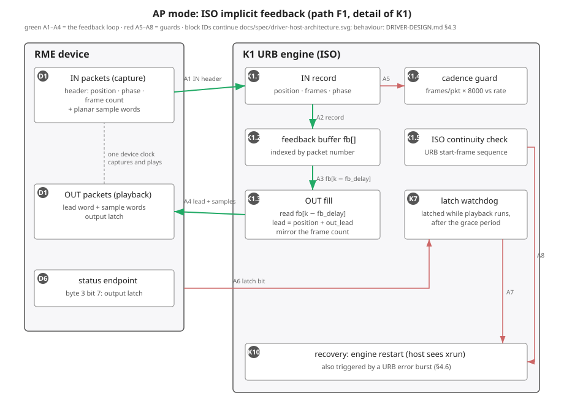

# Fireface USB driver design

This document describes the `snd-fireface-uc` kernel module: what it owns,
how it streams audio, how it talks to the host, and how to extend it to
another RME device. It is the low-level driver reference. Device protocol
encodings live in the protocol specifications. Mixer panels, scenes and GUI
behaviour belong to the host specifications.

Terminology:

| Term | Meaning |
|---|---|
| host | Any userspace client of the driver's PCM/hwdep interface: TotalControl, a command-line tool, or the vendor reference host on Windows or macOS. |
| reference host | The vendor's host driver, used as protocol evidence. |
| transport | The USB streaming path: interrupt or isochronous. |
| USB interface | A numbered `bInterfaceNumber` in the active configuration (IF0 audio, IF1 state/meter, IF2 MIDI, IF3 firmware programming, IF4 page stream, IF5 status). The protocol specifications own the numbering. |
| userspace interface | An ALSA node the host opens: PCM, hwdep or rawmidi. |
| personality | A device firmware/USB variant: UC PC, UC AP, UCX IF0, UCX IF5, Babyface-classic. |
| engine | The running URB set for one card. |
| quirk | A descriptor flag that selects a device-specific transport behaviour. |

Terms follow the USB core and ALSA conventions. Driver-specific terms are
defined above.

## 1. Boundary

The kernel module is a transport driver. The host owns the device model and
policy.

| Layer | Owns |
|---|---|
| `kernel/ffuc.c` | USB probe, descriptor table, alt/rate selection, URB engines, ALSA PCM, status/latch watchdog, recovery, suspend/resume |
| `kernel/ffuc-hwdep.c` | raw EP0 vendor requests, IF1 word bursts, meter/state readers, event queue, backpressure |
| `kernel/ffuc-midi.c` | USB-MIDI rawmidi ports |
| host | device model, protocol semantics, routing, scenes, meter decoding |

The kernel exposes these userspace interfaces:

- the ALSA PCM device (`hw:<card>,0`);
- one `snd-hwdep` control node per card (`/dev/snd/hwC<card>D0`);
- rawmidi ports where the device has USB-MIDI.

The host opens the hwdep node and implements the device model. The hwdep
node is the single control owner while the module is bound.

The driver claims the audio, state/meter, MIDI and status USB interfaces.
The firmware programming USB interface (IF3) and the page stream USB
interface (IF4) remain unclaimed; the firmware update tool uses IF3
directly.

The recommended host architecture is a device service thread that owns the
hwdep handle, plus a UI-side mirror. The service drains commands, polls
events and meters, and publishes snapshots. The UI queues commands and
reads the mirror; it never blocks on the device. The runtime structure is
defined in
[`../TOTALCONTROL-ARCHITECTURE.md`](../TOTALCONTROL-ARCHITECTURE.md) §5.

## 2. Device descriptors and quirks

`struct ffuc_device_desc` is the per-device table. USB IDs point at
descriptors through `.driver_info`. Each probe allocates its own
`struct ffuc`; model state is per-card.

A descriptor carries:

- identity: name, card id, vendor/product;
- transport: interface number, interrupt or ISO, audio/status/state/meter/MIDI
  endpoint numbers;
- modes: one `ffuc_mode` per alternate setting (words, packet sizes, max
  frames);
- channel counts, max rate, meter length;
- channel-init ranges (`0x16` slot ranges);
- quirks;
- `ffuc_ops` callbacks: `init`, `set_rate`, `stream_start`, `stream_stop`,
  `hw_mute`.

Quirks:

| Quirk | Meaning |
|---|---|
| `ALT_RESELECT` | select alt 0 then alt N at engine start (clears the UCX IF5 output latch) |
| `INT32_SAMPLES` | device requires S32 wire format |
| `STATUS_LATCH` | status byte 3 bit 7 is the output-latch watchdog |
| `IF5_PRE_START` | send `0x10 0x8000` + `0x1d` before audio |
| `IF5_PLAYBACK_MASK` | request 19/20 channel mask; IN URBs are 73728 bytes |
| `WIN_SESSION` | Windows-personality session timing: stop->start settle and close->rate / close->trio gaps |

Model-specific behaviour belongs in a descriptor quirk or an `ffuc_ops`
callback; the shared PCM/URB path stays model-independent.

## 3. Personalities and wire formats

| Personality | Transport | Wire | Notes |
|---|---|---|---|
| UC PC | interrupt IF0 | float32 (Linux/macOS), S32 (Windows reference host) | status ticker IF5; session words after a live rate change |
| UC AP | ISO IF0 | float32 | IN header + planar frames; OUT per-frame lead word |
| UCX IF0 | ISO IF0 | float32 | default UCX path |
| UCX IF5 | interrupt IF5 | S32 | opt-in `ucx_if5=1` |
| Babyface-classic | ISO IF0 | float32 | UCX-family packet format; 12 capture / 14 playback words at 1x |

The wire format is resolved at probe (`ffuc_wire_s32`). The host imposes the
format through the channel-init value; the kernel converts between the wire
format and the ALSA format.

PC vs AP limitations:

- PC uses interrupt URBs and the Windows session words. A live rate change
  arms `session_reopen`/`uc_session`; later opens/closes replay the session
  trio/close word. The Windows-personality gaps are device-mandated timing
  (see §7).
- AP uses ISO implicit feedback. The IN header carries position and phase;
  the OUT lead word places playback against the captured clock. There is no
  Windows session settle on AP.
- The UC keeps its rate family across personality switches; a USB reset
  restores the 1x multiplier and forces a session replay on PC.

## 4. Streaming engine

### 4.1 URB and buffer geometry

Module parameters: `urb_frames` (default 48), `nurbs` (default 2),
`ucx_if5_frames` (default 1024), `fixed_rate`.

- Interrupt: one URB carries `urb_frames` scaled by the rate band
  (1x/2x/4x). The PCM buffer covers `(nurbs + 2) * urb_frames`, rounded up
  to whole periods.
- ISO: one URB carries up to 8 packets, one per 125 us microframe. The
  feedback delay is `(nurbs + 1) * iso_packets`. The UCX PCM buffer also
  covers the output lead plus two URBs of margin.
- The period floor is one URB. The graph quantum follows at 48 frames and
  above.

The PCM buffer covers the URBs already in flight plus margin. A completion
that overwrites unread capture frames or sends unwritten playback frames is
counted as `in_overruns` / `out_underruns`. The host prevents these through
its buffer/quantum choice.

### 4.2 Period signalling gate

A period signal announces one completed period. A direction is signalled
only when its period index advanced (`delta_zero` counts violations).

In duplex, the wake is withheld until both running directions have completed
a period, so the follower's pointer is current when the reader wakes. A
direction whose wake has been withheld twice signals alone, releasing the
other direction. Single-direction operation signals at its own boundary.

Counters: `signal_deferred`, `signal_overdue`, `max_pending`, `delta_zero`,
`hw_ptr_mismatch`.

The gate adds at most about one URB of latency at any period size. It is a
correctness mechanism.

### 4.3 ISO implicit feedback and dropout prevention

The ISO IN header carries a position and a phase accumulator. The driver
records every IN packet's position and frame count in a feedback buffer
(`fb[]`), indexed by packet number. The OUT path reads the feedback entry
`fb_delay` packets behind the current OUT packet and places the OUT lead
word accordingly. This is implicit feedback: the device's captured clock
schedules playback, keeping the two directions aligned.

Fields that assist dropout prevention:

| Field | Role |
|---|---|
| IN position | the device's capture buffer position; anchors the feedback timeline |
| IN phase | fractional-sample accumulator; predicts frame add/drop at the wrap |
| IN frame count | frames in this packet; the OUT path mirrors it |
| OUT lead word | the buffer position this OUT packet plays at; keeps the device's output latch fed |
| `out_lead` | host-side margin added to the mirrored position; absorbs scheduling jitter |
| `fb_delay` | how far OUT lags IN; covers the URBs in flight |
| cadence | mean frames/packet * 8000; detects a rate mismatch |
| output-latch bit | status byte 3 bit 7; the device signals that its output latch ran dry |

How the vendor likely uses them: the macOS reference host reads the IN
position/phase to schedule OUT packets against the device clock, and uses
the output-latch status to detect underrun. The Windows interrupt path uses
the session words and the status ticker. The driver's ISO path reproduces
the macOS implicit-feedback model; the interrupt path reproduces the
Windows session model.

The cadence guard is a diagnostic: a sustained disagreement between the
packet cadence and `chip->rate` marks a rate mismatch. Recovery is the
watchdog's role.

### 4.4 Recovery and watchdog

- URB errors above `FFUC_MAX_URB_ERRORS` mark the engine broken and queue
  `recover_work`.
- ISO URB queue discontinuity (`ffuc_iso_contiguous`) marks the engine
  broken.
- The status latch watchdog arms after `FFUC_STATUS_GRACE_MS`; a latched
  output while playback runs marks the engine broken.
- `recover_work` stops the streams, stops the engine, and restarts it if
  any direction is prepared.

Recovery restarts the engine. The host sees an xrun and re-prepares.

## 5. Control transports and hwdep ABI

The hwdep ABI is versioned (`FFUC_ABI_VERSION`). The host checks it at open.

| ioctl | Function |
|---|---|
| `INFO` | identity, capabilities, endpoint numbers, rate, firmware |
| `VENDOR` | one EP0 vendor request (read or write, up to 64 bytes) |
| `WRITE_WORDS` | up to 63 IF1 register words; the kernel adds odd parity |
| `COUNTERS` | transport health counters |

`read()`/`poll()` deliver events:

| Event | Payload |
|---|---|
| `METER` | raw meter packet; UC heartbeats are paired (RMS then peak) |
| `STATE` | raw IF1 `0x8d` words |
| `STATUS` | raw status endpoint packet |
| `LATCH` | output-latch transition |

The event FIFO is 64 KiB. A full FIFO drops events and increments
`events_dropped`; the host must drain promptly.

### 5.1 Meter backpressure

The UC meter endpoint is reader-triggered. The driver submits the next page
only while the FIFO is below the high-water mark; it pauses at a pair
boundary. A reader that drains below the low-water mark resumes the pump.
The last reader closing stops the pump and drains the partner page to
preserve the device's page phase for the next session.

The host owns the single-reader discipline; concurrent readers break the
pair phase model.

### 5.2 Host obligations

The host:

- drains the event FIFO promptly; a stalled reader drops events;
- keeps one meter reader;
- chooses a buffer/quantum that covers the URB queue plus margin;
- checks engine state before control writes that assume a running engine;
- treats recovery as an xrun and re-prepares;
- uses the hwdep node as the control owner.

The driver keeps the host responsive: control ioctls are synchronous but
bounded; event reads wait interruptibly; the meter pump is backpressured.

## 6. MIDI

USB-MIDI is on the vendor MIDI interface (bulk OUT/IN). The driver exposes
one rawmidi port per logical port. Both directions use USB-MIDI code index
numbers. The unit parses each bulk transfer as a separate MIDI stream; a
message must fit one transfer. Output is polled by a delayed work at 1 ms.

## 7. Rate, session and startup timing

Engine start selects the alternate setting, commits the rate, sends the
session-open words where required, sets up URBs, submits them, and unmutes.

The UC Windows-personality path uses three timed gaps:

| Gap | Value | Reason |
|---|---|---|
| stop -> start settle | 250 ms | minimum gap the device requires after the close word before a start |
| close -> rate write | 200 ms | minimum gap the device requires after the close word before the rate write |
| close -> session trio | 200 ms | minimum gap the device requires after the close word before the session trio |

These are device-mandated timing measured on the Windows reference-host
captures. The AP personality sends the session words back-to-back.

Design principle: prefer a deterministic readiness condition over a timed
guess. Where the device exposes a status that can be polled (rate index,
session state, output latch), the driver polls it with a bounded timeout.
Where the device provides no acknowledgement, the wait is a documented
device quirk with capture evidence, expressed as a named quirk constant.
See the TODO section for the readiness-poll work.

## 8. Suspend, resume and hotplug

- Suspend records the running directions, stops the engine, suspends MIDI
  and the raw transports. ALSA suspend is entered only when every prepared
  direction was running.
- Resume re-runs hardware init and restarts the engine if prepared. A USB
  reset forces alt reselection and a UC session replay.
- Disconnect marks the card disconnected, kills URBs, cancels recovery,
  cleans up hwdep/MIDI, and frees the card when closed.

## 9. Latency inputs

The driver exposes the queue geometry (`urb_frames`, `nurbs`,
`iso_packets`, `fb_delay`, `out_lead`) and the transport counters. The host
computes round-trip latency from these inputs and its loopback calibration;
that model is defined in
[`../TOTALCONTROL-ARCHITECTURE.md`](../TOTALCONTROL-ARCHITECTURE.md) §10.

## 10. Open items

These items narrow the remaining investigation. They are implementation
risks or tuning questions, not shipped behaviour.

### Driver risks

- The duplex period gate reads and increments `deferrals` without a lock
  shared across directions. Concurrent URB completions on different CPUs
  could race the gate counters. The signal itself is under the stream lock;
  the gate decision is not.
- `ffuc_hwdep_cleanup` runs in disconnect and again in `private_free`. A
  reader that passed the disconnected check could race the FIFO free.
  Cleanup should be ordered against hwdep unregistration.
- `ffuc_iso_contiguous` uses a module-global `start_logged` counter shared
  across devices/endpoints. It should be per-endpoint.
- The hwdep read path allocates a temporary buffer per event. A per-reader
  buffer would remove the allocation from the event path.
- The PCM trigger stop path emits verbose diagnostic logs on every stop.
  These should be debugfs/ratelimited or behind a diagnostic parameter.
- `ffuc_poison` memsets the whole PCM buffer on every prepare. This is a
  diagnostic; it should be optional for production.
- `COUNTERS.status_urbs` is always zero; the status URB counter is not
  exposed.
- `INFO.outputs` uses the playback channel count; on Babyface-classic the
  hardware output count differs. Verify the ABI field semantics.

### Host interaction

- The recommended host service loop drains commands and events on one
  thread. A blocking control burst can delay event draining and drop
  events. Separating control writes from the event drain would keep the
  meter/state pump responsive under heavy write load.

### Heuristic waits

The timed gaps in §7 are device-mandated but currently fixed sleeps. The
status/meter pump uses 4 ms delayed work and 10 ms retry. The host burst
pacing uses a fixed gap. These should be replaced by deterministic
readiness/flow-control where the device exposes it, or documented as
device-mandated timing where it does not.

## 11. TODO / future optimizations

- Replace fixed session gaps with a bounded poll of a device-visible
  readiness condition where one exists; keep documented quirks where the
  device has no acknowledgement.
- Add a rate-readiness poll after the rate commit instead of assuming the
  write took effect.
- Serialize the duplex gate decision or make the deferral counters atomic.
- Order hwdep cleanup against card unregistration; remove the double
  cleanup path.
- Move ISO continuity logging to per-endpoint state.
- Preallocate the hwdep read buffer per reader.
- Make buffer poison and verbose stop diagnostics optional module parameters.
- Resubmit meter/state URBs from completion where backpressure allows,
  instead of a fixed 4 ms delayed work.
- Expose the status URB counter; verify the INFO output/playback fields.
- Run `sparse` (`make C=1`) and lockdep/UBSAN on the module; fix warnings.
- Reduce checkpatch block-comment warnings to meet kernel style.

## 12. Open protocol items

The phase/position fields and meter page phase are documented in the UC
protocol specification. Items that remain unverified there stay open there.
The driver forwards raw packets and exposes the counters; the host owns the
decoding.

## 13. Code map

| Concern | Source |
|---|---|
| descriptor table, quirks, modes | `kernel/ffuc.c` |
| URB engines, period gate, ISO feedback | `kernel/ffuc.c` |
| PCM ops, buffer geometry | `kernel/ffuc.c` |
| status/latch watchdog, recovery | `kernel/ffuc.c` |
| hwdep ABI, event queue, meter pump | `kernel/ffuc-hwdep.c`, `kernel/ffuc-uapi.h` |
| meter heartbeat pairing | `kernel/ffuc-meter-pair.h` |
| USB-MIDI | `kernel/ffuc-midi.c` |
| host ABI binding | `ui/totalcontrol/totalcontrol-core/src/fireface/abi.rs` |
| host protocol/model | `ui/totalcontrol/totalcontrol-core/src/fireface/` |

## 14. Adding support for a device

A new device is a descriptor entry plus, where the streaming sequence
differs, an `ffuc_ops` implementation. The shared PCM/URB path stays
model-independent.

### 14.1 Evidence first

Capture the device before writing code:

- USB descriptors: configurations, interfaces, alternate settings,
  endpoint addresses and packet sizes.
- The streaming wire format: sample word format, packet layout, any header
  or lead word, channel counts per rate band.
- The control transports: EP0 vendor requests, any bulk register/meter
  channel, the status endpoint.
- The init and rate sequences from the reference host.

Document every register/offset in a protocol specification. Mark uncertain
mappings as open items; the driver carries only verified behaviour.

### 14.2 Descriptor

Add an entry to `ffuc_devices[]` and a USB ID to `ffuc_ids[]`:

| Field | Source |
|---|---|
| `vendor`, `product`, `iface` | USB descriptors |
| `transport` | interrupt or ISO |
| `audio_iface`, `out_ep`, `in_ep` | streaming interface |
| `status_iface`, `status_ep`, `status_bulk` | status ticker, if present |
| `state_iface`, `state_out_ep`, `state_in_ep`, `meter_in_ep` | bulk control/meter channel, if present |
| `midi_iface`, `midi_out_ep`, `midi_in_ep`, `midi_ports` | USB-MIDI, if present |
| `modes[]` | one `ffuc_mode` per alternate setting: words, out_words, pkt_frames, in_mps, out_mps, max_frames |
| `max_channels`, `max_playback`, `max_rate`, `meter_len` | channel counts and meter packet size |
| `chan_init[]`, `n_chan_init` | `0x16` slot ranges |
| `quirks` | only behaviour the shared path must select |
| `ops` | `init`, `set_rate`, `stream_start`, `stream_stop`, `hw_mute` |

The wire format is resolved at probe by `ffuc_wire_s32()`. A device that
requires S32 carries `INT32_SAMPLES`; the default is float32.

### 14.3 Ops and quirks

Implement `ffuc_ops` only for the sequences that differ from the existing
models. Reuse an existing ops table where the sequence matches.

Add a quirk only when the shared path must branch on a device property.
Name the quirk after the behaviour, document the capture that establishes
it, and keep the timing constants named.

### 14.4 Host side

Add the host profile and protocol module separately. The driver exposes raw
transports and counters; the host owns the device model, meter decoding and
scenes. Follow `docs/CONTRIBUTING-NEW-DEVICE.md` for the host integration.

### 14.5 Tests

- Kernel: build with `make -C kernel`, run `make -C kernel test`, run
  `checkpatch.pl` and `sparse` (`make C=1`).
- Transport: verify URB geometry, period signalling and recovery on the
  device; record the counters.
- Host: add encoding tests for the new protocol module.
- Hardware: verify each rate band, both directions, suspend/resume and
  hotplug. Preserve the user scene and configuration.
