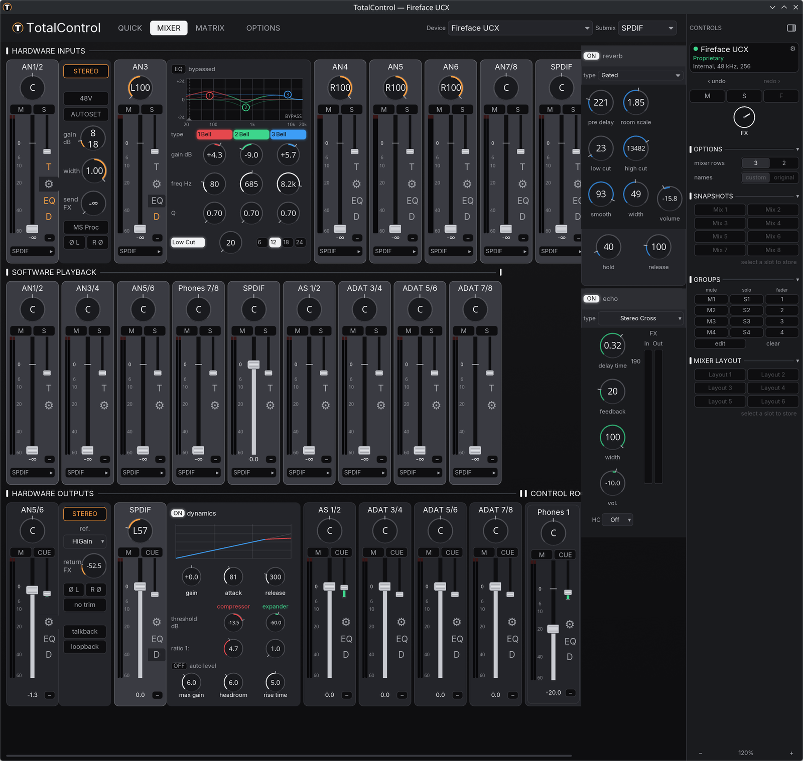

<div align="center">


# TotalControl

**The TotalMix experience for RME interfaces, native on Linux.**

  [](docs/guide.md#license)

<br>



</div>

<br>

Routing, gains, monitoring, EQ, FX sends and scenes for RME interfaces,
without the Windows software. Reverse-engineered from the vendor protocol and
validated on real hardware.

> **Supported today:** the Fireface UC and Fireface UCX. Babyface-classic
> support is experimental.

- **Three views**: Quick, Mixer and Matrix
- **The whole DSP mixer**: preamp, trim, EQ, width, loopback, mute/solo groups
- **Snapshots and layouts**, undo/redo, custom channel names
- **Lives in the tray**: the front-panel DIM button and your mix survive a replug
- **GUI and TUI**, over the [kernel driver](../../kernel/README.md)

## Install

```sh
paru -S totalcontrol        # Arch, CachyOS
```

Other distributions: `cargo build --release`, see the
[guide](docs/guide.md#building-from-source).
Try it without hardware: `totalcontrol --mock` simulates a Fireface UCX,
`totalcontrol --mock-ucx` a Fireface UCX, `totalcontrol --mock-uc` a
Fireface UC and `totalcontrol --mock-classic` a Babyface-classic. Each brings the panels its unit really has — the UCX adds EQ,
dynamics, FX and the Control Room; the UC shows the gated set. Both are also
selectable in the Device picker.

## Learn more

<div align="center">

[Guide](docs/guide.md) · [Changelog](CHANGELOG.md) · [Contributing](CONTRIBUTING.md) · [Kernel driver](https://github.com/ismail-bahloul/babyface-pro-linux)

</div>
