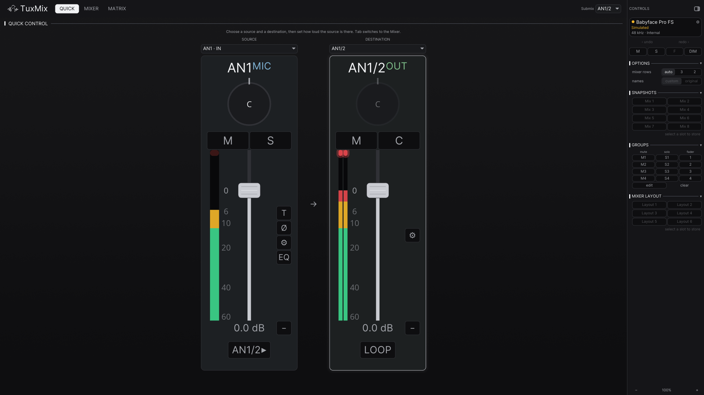
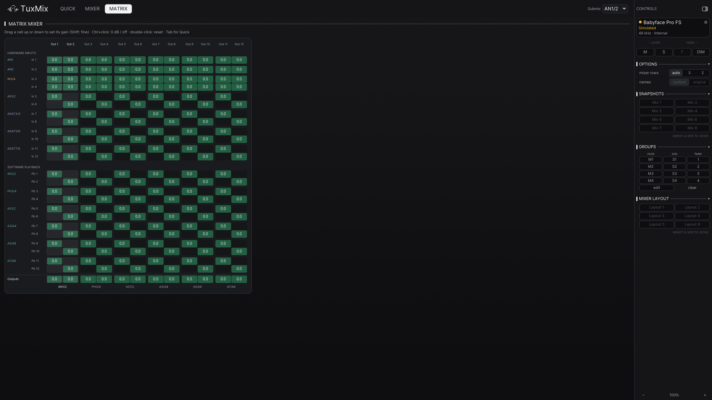

# TotalControl guide

The details behind the [README](../README.md): views, background mode, how
TotalControl fits into the Linux audio stack, the workspace layout and the
project status.

The full end-user manual lives at [`../../../docs/TOTALCONTROL_Manual.md`](../../../docs/TOTALCONTROL_Manual.md).

- [Views](#views)
- [Running in the background](#running-in-the-background)
- [The Linux audio stack](#the-linux-audio-stack)
- [Workspace](#workspace)
- [Status](#status)
- [Building from source](#building-from-source)
- [License](#license)

## Views

| Quick | Matrix |
|:---:|:---:|
|  |  |

- **Quick**: one source into one destination, the fastest way to a mix.
- **Mixer**: every strip, TotalMix-style, on three rows (hardware inputs,
  software playback, hardware outputs) or two on a wide window.
- **Matrix**: the full routing grid.

`totalcontrol --view quick|mixer|matrix` opens a given view; `--mock`, `--mock-ucx`
and `--mock-uc` run against a simulated Babyface Pro FS, Fireface UCX or
Fireface UC, no hardware needed. Each simulation carries exactly the panels its
unit has, so the UCX one shows EQ, dynamics, FX and the Control Room while the
UC one shows the gated set. All three are also listed in the Device picker.

## Running in the background

With a system tray (KDE Plasma, or GNOME with the AppIndicator extension),
closing the window keeps TotalControl running, as TotalMix does on Windows: the
front-panel DIM button and the restore of your mix after a replug are
TotalControl's job while it runs. The tray icon toggles the window; its menu has
Dim, Recall mix 1-8, Settings and Quit. `totalcontrol --minimized` starts hidden,
and Settings (Ctrl+,) can start TotalControl with your session. Without a tray,
closing the window quits. One TotalControl runs per session: a second launch shows
the first.

## The Linux audio stack

Two ways to get sound from the Babyface Pro FS:

1. **Kernel driver** (sibling repo
   [`kernel/README.md`](../../../kernel/README.md)):
   the production path. It exposes a real ALSA card (PipeWire sink/source,
   low latency) whose mixer is the ALSA control set, and TotalControl drives it
   through the ALSA backend.
2. **TotalControl's USB backend** (libusb): the reference/development path for
   full control and streaming without the kernel driver.

`tools/alsa/` has the ALSA plugin and PipeWire configuration glue.

## Workspace

- **`totalcontrol-usb`**: the low-level USB backend, the full vendor protocol of
  the Babyface Pro FS proprietary mode (crosspoints, masters, gains, preamp,
  EQ, pitch, loopback, width, FX, the front-panel emulation),
  reverse-engineered from Windows captures and validated on hardware. It
  refuses to open the device while the kernel driver
  (`snd-usb-babyface-pro`) owns it.
- **`totalcontrol-core`**: the device model and control API (`RmeDevice` trait)
  with three backends: USB (libusb), ALSA (the kernel driver's controls) and
  mock (tests, scenes).
- **`totalcontrol-gui`** (iced) and **`totalcontrol-tui`** (ratatui): the interfaces.
  Custom canvas faders, VU meters with real ballistics, multi-select, live
  routing matrix. `GUI-NOTES.md` holds the design log.
- **`totalcontrol-sys`**: FFI bindings.

## Status

- The protocol layer (`totalcontrol-usb` + `totalcontrol-core`) is complete and
  hardware-validated: the laws are calibrated, not guessed.
- The GUI and TUI are functionally complete; the road to 1.0 is validation
  on real hardware and desktops (tray on KDE/GNOME), see
  [`CHANGELOG.md`](../CHANGELOG.md).
- The ALSA backend (`totalcontrol-core`'s `alsa` feature) is hardware-validated,
  including Input/Playback Mute and Solo, which zero the crosspoints the way
  the USB backend does.
- The ALSA backend follows the card: changes made by the front panel,
  `alsamixer`, `alsactl restore` or any other client show up in the GUI
  within a tick. It also plays TotalMix's part for the DIM button: the
  kernel driver only counts presses (`DIM Button Press Count`) and TotalControl
  toggles `Dim` on each one, so the hardware DIM button works while TotalControl
  runs. `cargo run --example panel-watch` prints what the backend sees.
- See the sibling driver repo for the kernel-side status.

## Building from source

```sh
cargo build --release          # the whole workspace
cargo test                     # protocol laws, panel state machine, GUI state, ...
cargo build -p totalcontrol-core --no-default-features --features usb
```

The binaries land in `target/release/`: `totalcontrol-gui` (installed as `totalcontrol`
by the AUR package) and `totalcontrol-tui`.

## License

`totalcontrol-core` is MIT. `totalcontrol-gui` and `totalcontrol-tui` are GPL-3.0-only.
`totalcontrol-usb` is GPL-3.0-or-later and `totalcontrol-sys` is GPL-3.0. The built
binaries link the GPL crates, so as a whole they are GPL-3.0, which is the
license the AUR package declares. See [`LICENSE`](../LICENSE) and
[`COPYING`](../COPYING).
